<p align="center">
  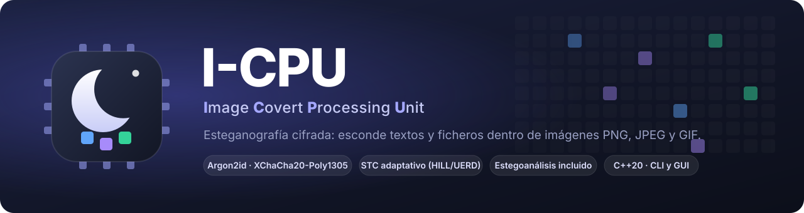
</p>

<p align="center">
  <a href="https://github.com/jossseluuu/I-CPU/actions/workflows/ci.yml"></a>
  <a href="LICENSE"></a>
  
  
  
</p>

<p align="center">
  <a href="docs/guias/primeros-pasos.md"><b>Primeros pasos</b></a> ·
  <a href="docs/README.md"><b>Documentación</b></a> ·
  <a href="docs/guias/perfiles.md">¿Para quién es?</a> ·
  <a href="docs/tecnico/arquitectura.md">Cómo funciona</a> ·
  <a href="docs/guias/experimentos.md">Experimentos</a>
</p>

**I-CPU** esconde un texto o un fichero **dentro de una imagen**: lo cifra con tu contraseña y lo
reparte entre los píxeles, los coeficientes de un JPEG o los colores de un GIF, de forma que la
imagen parece la misma. Sin la contraseña no se puede leer, y está diseñado para que tampoco sea
fácil saber que hay algo. Todo en local, en un solo ejecutable, sin conexión a Internet.

<p align="center">
  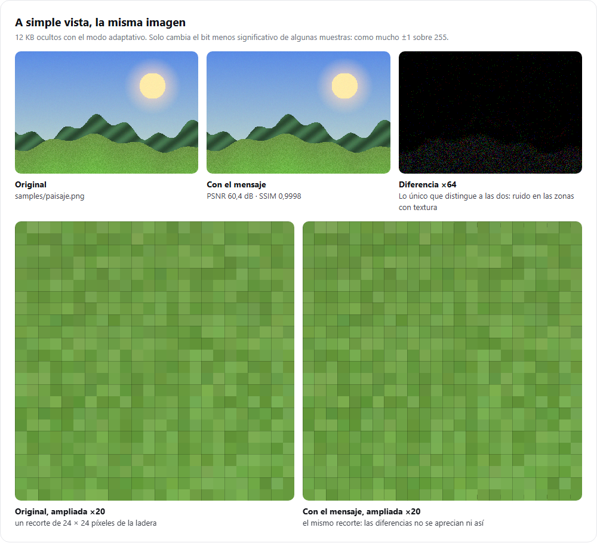
</p>

## Por qué «I-CPU»

Empezó como un **procesador de imágenes**: un programa que interpreta una imagen pieza a pieza y
puede reescribirla sin que cambie su aspecto. Hoy el nombre se lee como **Image Covert Processing
Unit**, una unidad de procesamiento *encubierto* de imágenes. La luna del logo viene de su primer
nombre, *Umbra* («sombra»). [La historia completa](docs/sobre-el-proyecto.md#por-qué-i-cpu).

<p align="center">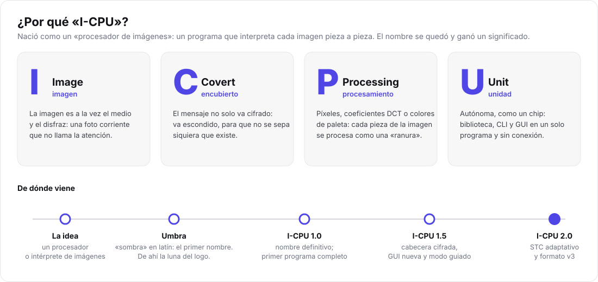</p>

## Qué hace

- 🔒 **Cifrado fuerte.** Argon2id (64 MiB) para la contraseña y XChaCha20-Poly1305 para el mensaje:
  sin la contraseña no se lee, y cualquier modificación se detecta.
- 🫥 **Inserción adaptativa.** Syndrome-Trellis Codes con costes HILL y UERD: cambia pocas muestras y
  solo donde hay textura, con una carga prudente. Si el mensaje no cabe, lo dice en lugar de arriesgarse.
- 🖼️ **Tres dominios.** Píxeles (PNG, BMP, TGA, QOI, PNM), coeficientes DCT (JPEG, sin recomprimir)
  e índices de paleta (GIF, también animados).
- 🔬 **Estegoanálisis incluido.** Chi-cuadrado (con barrido por ventanas), análisis RS, PSNR, SSIM y
  un banco de experimentos para medir lo detectable que es cada configuración.
- 🖥️ **Dos interfaces.** Una GUI web local, pulida y sin dependencias, y una CLI con modo guiado.
- 🧪 **Hecho con cuidado.** 68 pruebas, CI en Windows y Linux, AddressSanitizer, UBSan y fuzzing.

## La interfaz

<table>
  <tr>
    <td width="50%">
      <picture>
        <source media="(prefers-color-scheme: dark)" srcset="docs/img/gui/ocultar-oscuro.png">
        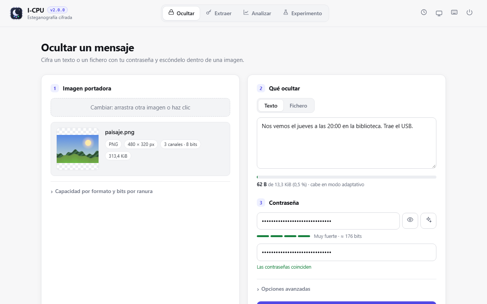
      </picture>
      <p align="center"><b>Ocultar</b>: arrastra una foto, escribe el mensaje y genera una contraseña</p>
    </td>
    <td width="50%">
      <picture>
        <source media="(prefers-color-scheme: dark)" srcset="docs/img/gui/extraer-oscuro.png">
        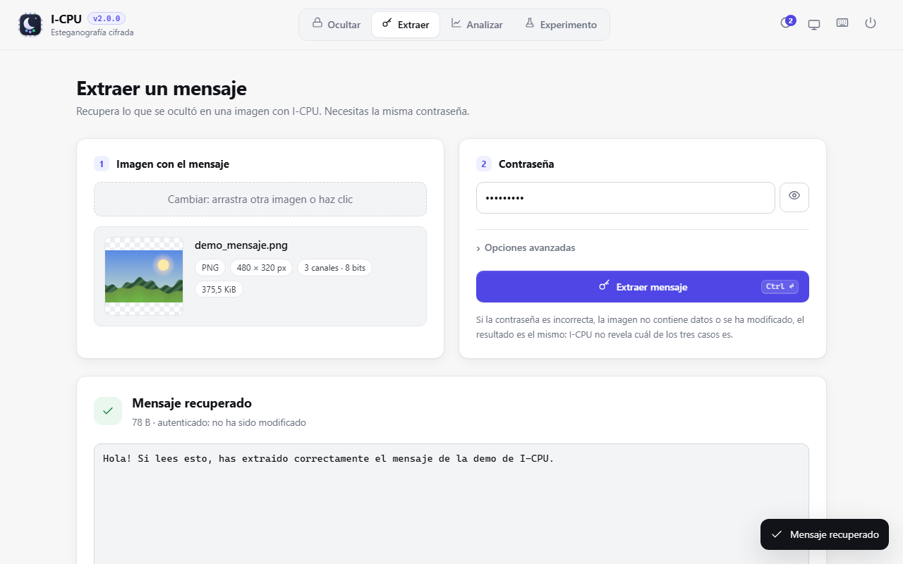
      </picture>
      <p align="center"><b>Extraer</b>: la misma contraseña recupera el texto o el fichero</p>
    </td>
  </tr>
  <tr>
    <td width="50%">
      <picture>
        <source media="(prefers-color-scheme: dark)" srcset="docs/img/gui/ocultar-resultado-oscuro.png">
        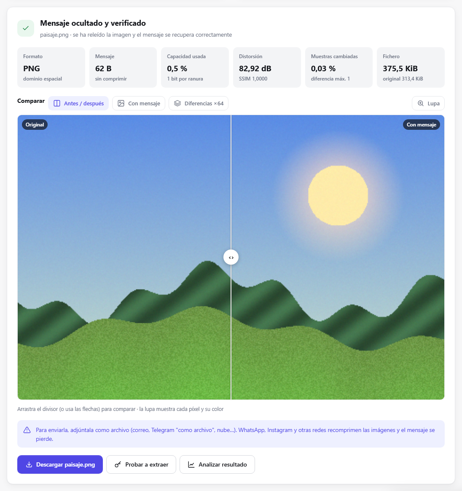
      </picture>
      <p align="center"><b>Resultado</b>: comparador, diferencias ×64, lupa y métricas</p>
    </td>
    <td width="50%">
      <picture>
        <source media="(prefers-color-scheme: dark)" srcset="docs/img/gui/experimento-graficas-oscuro.png">
        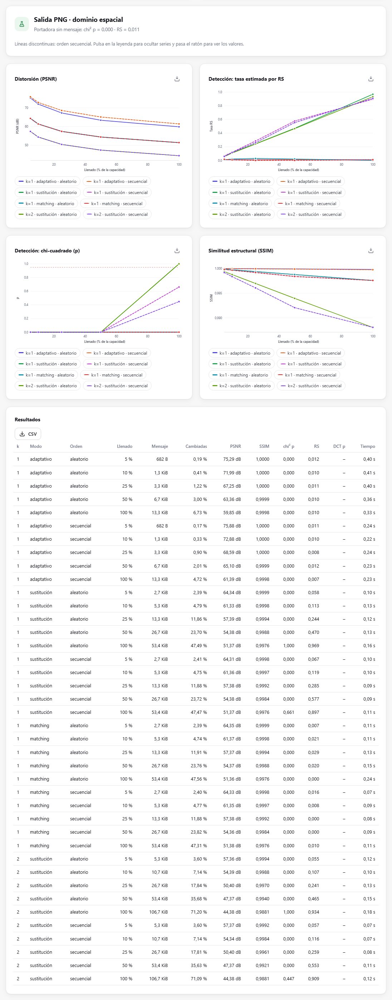
      </picture>
      <p align="center"><b>Experimento</b>: compara modos y cargas con tus propias fotos</p>
    </td>
  </tr>
</table>

Las capturas siguen el tema de tu GitHub (claro u oscuro). Recorrido completo en la
[guía de la interfaz gráfica](docs/guias/interfaz-grafica.md).

## Inicio rápido

**Windows**, con las [Build Tools para Visual Studio](https://visualstudio.microsoft.com/es/downloads/)
(«Desarrollo para el escritorio con C++»):

```bat
git clone https://github.com/jossseluuu/I-CPU.git && cd I-CPU
scripts\build.bat test
build\msvc-release\apps\gui\icpu-gui.exe
```

**Linux / macOS**: `cmake --preset release && cmake --build --preset release && ctest --preset release`.

¿Prefieres no compilar? Descarga el artefacto `icpu-windows-x64` de la última ejecución de la
[CI](https://github.com/jossseluuu/I-CPU/actions). Detalles y problemas frecuentes: [Instalación](docs/guias/instalacion.md).

### Desde la consola

```bat
icpu embed foto.png -o foto_copia.png -m "Nos vemos a las 8"   &rem pide la contraseña sin mostrarla
icpu extract foto_copia.png
icpu info foto.png                                            &rem cuánto cabe
icpu                                                          &rem modo guiado paso a paso
```

Prueba con las demos: `icpu extract samples\demo_mensaje.jpg -p icpu-demo`.
Referencia completa: [Línea de comandos](docs/guias/linea-de-comandos.md).

## Cómo funciona

<p align="center">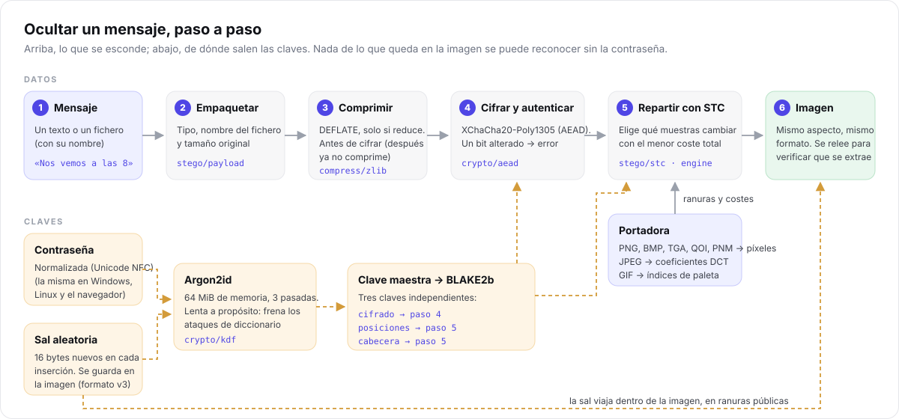</p>

1. El mensaje se **empaqueta**, se **comprime** y se **cifra** con XChaCha20-Poly1305.
2. La contraseña pasa por **Argon2id** con una **sal aleatoria** nueva, que se guarda en la imagen;
   de ahí salen tres claves: cifrado, posiciones y cabecera.
3. **STC** elige qué muestras cambiar para escribir esos bits con el menor «coste» visual y estadístico.

<p align="center">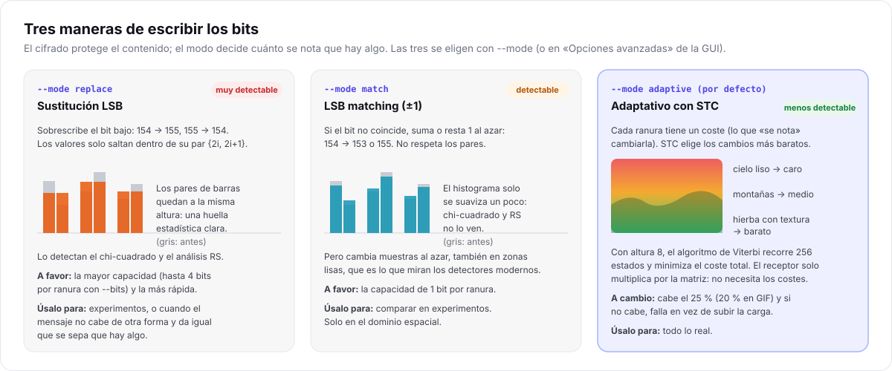</p>

Más a fondo: [arquitectura](docs/tecnico/arquitectura.md) · [esteganografía y STC](docs/tecnico/esteganografia.md) ·
[criptografía](docs/tecnico/criptografia.md) · [formato v3 byte a byte](docs/tecnico/formato.md).

## Resultados

El mismo mensaje de **12 KB** en una imagen de 480 × 320, de cuatro formas:

<p align="center">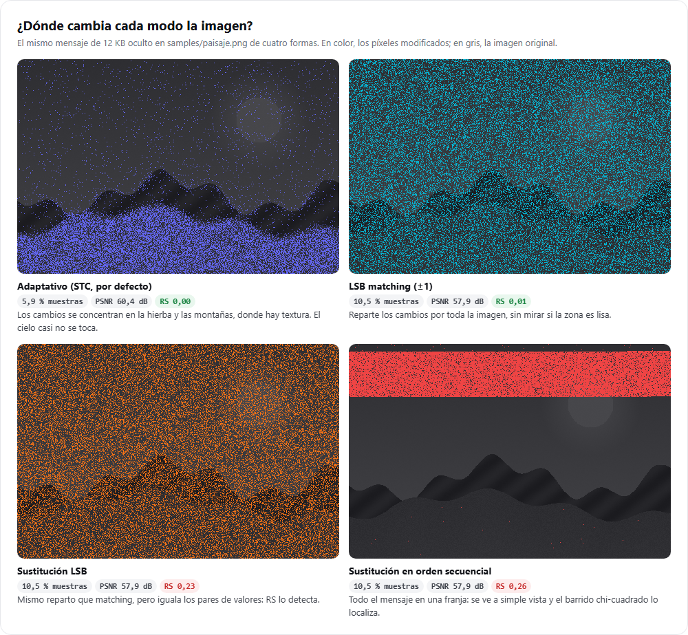</p>

| Modo | Muestras cambiadas | PSNR | Análisis RS | Lectura |
| --- | --- | --- | --- | --- |
| Portadora limpia | — | — | 0,01 | referencia |
| **Adaptativo (por defecto)** | **5,9 %** | **60,4 dB** | **≈ 0,00** | menos cambios y solo en la textura |
| LSB matching | 10,5 % | 57,9 dB | 0,01 | RS no lo ve, pero toca zonas lisas |
| Sustitución LSB | 10,5 % | 57,9 dB | **0,23** | RS lo detecta |

<p align="center">
  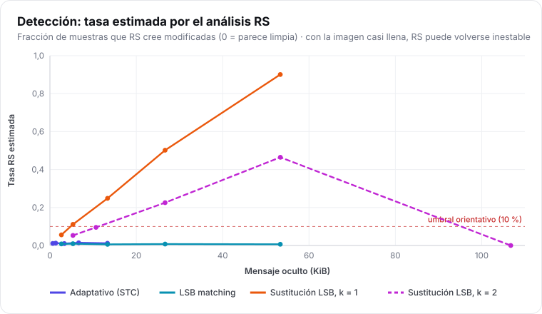
  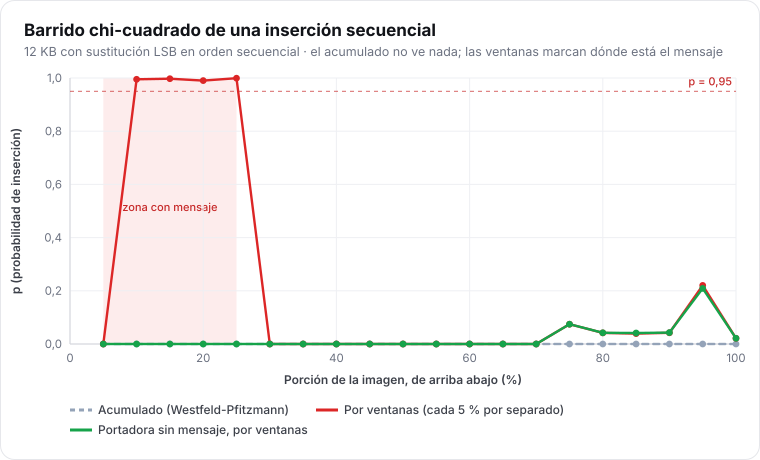
</p>

Todas las cifras y figuras se regeneran con `node scripts/generar_figuras.mjs`. Cómo leerlas y cómo
hacer tus propios experimentos: [guía de experimentos](docs/guias/experimentos.md).

## Qué protege y qué no

<p align="center">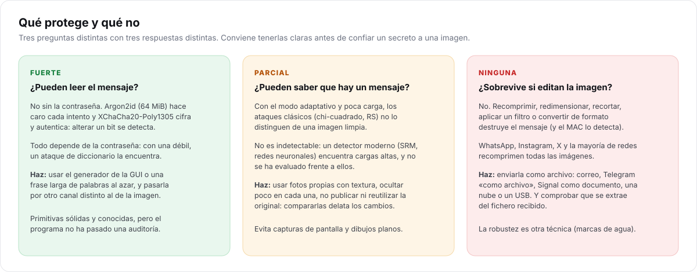</p>

- **Contenido: fuerte.** Sin la contraseña no se puede leer ni modificar sin que se note. Depende de
  una contraseña buena: usa el generador de la GUI.
- **Existencia: parcial.** Con el modo adaptativo y poca carga resiste los ataques clásicos, pero
  **no es indetectable**: no se ha evaluado frente a detectores modernos, y quien tenga la original
  puede compararla.
- **Durabilidad: ninguna.** Recomprimir, redimensionar o editar la imagen destruye el mensaje. Las
  redes sociales y WhatsApp recomprimen: **envíala como archivo**.

I-CPU es un proyecto personal de aprendizaje. Usa primitivas criptográficas sólidas, pero **no ha
sido auditado**. Para vulnerabilidades, sigue [SECURITY.md](SECURITY.md) y no abras un issue público.
Antes de confiarle algo, lee las [buenas prácticas](docs/guias/buenas-practicas.md).

## Documentación

| Empezar | Usar | Entender |
| --- | --- | --- |
| [Instalación](docs/guias/instalacion.md) | [Interfaz gráfica](docs/guias/interfaz-grafica.md) | [Arquitectura](docs/tecnico/arquitectura.md) |
| [Primeros pasos](docs/guias/primeros-pasos.md) | [Línea de comandos](docs/guias/linea-de-comandos.md) | [Esteganografía y STC](docs/tecnico/esteganografia.md) |
| [¿Para quién es?](docs/guias/perfiles.md) | [Buenas prácticas](docs/guias/buenas-practicas.md) | [Criptografía y amenazas](docs/tecnico/criptografia.md) |
| [Preguntas frecuentes](docs/preguntas-frecuentes.md) | [Experimentos](docs/guias/experimentos.md) | [Formato v3](docs/tecnico/formato.md) |
| [Glosario](docs/glosario.md) | [Biblioteca C++](docs/tecnico/biblioteca.md) | [Estegoanálisis](docs/tecnico/estegoanalisis.md) |
| [Sobre el proyecto](docs/sobre-el-proyecto.md) | [API HTTP](docs/tecnico/interfaz-web.md) | [Decisiones de diseño](docs/tecnico/decisiones-de-diseno.md) |

Índice completo: [docs/](docs/README.md).

## Estructura del repositorio

```text
include/icpu/   API pública (icpu.hpp: embed/extract/inspect · report.hpp: analyze/bench)
src/            biblioteca icpu_core: core, crypto, compress, image, jpeg, gif, stego, analysis
apps/cli/       icpu.exe (comandos, ayuda y modo guiado)
apps/gui/       icpu-gui.exe (servidor HTTP local + web embebida en el ejecutable)
tests/          68 pruebas doctest; golden/ con imágenes reales de cada versión del formato
fuzz/           objetivo libFuzzer para los decodificadores
scripts/        compilación, muestras, demos y figuras de la documentación
samples/        portadoras de ejemplo y demos (contraseña: icpu-demo)
experiments/    script de experimentos (resultados en output/, ignorado)
docs/           documentación, diagramas, capturas y resultados
third_party/    dependencias incluidas (versiones en VERSIONS.txt)
```

## Dependencias

Todas están incluidas en `third_party/` y se compilan con el proyecto
(versiones exactas en [third_party/VERSIONS.txt](third_party/VERSIONS.txt)).

| Biblioteca | Uso | Licencia |
| --- | --- | --- |
| [Monocypher](https://monocypher.org/) 4 | Argon2id, XChaCha20-Poly1305, BLAKE2b | BSD-2 / CC0 |
| [libjpeg-turbo](https://libjpeg-turbo.org/) 3 | coeficientes DCT de JPEG | BSD-3 / IJG |
| [stb](https://github.com/nothings/stb) | lectura de formatos, BMP/TGA y DEFLATE | MIT / dominio público |
| [cpp-httplib](https://github.com/yhirose/cpp-httplib) | servidor de la GUI | MIT |
| [doctest](https://github.com/doctest/doctest) | pruebas | MIT |

## Contribuir

Se agradecen issues, ideas y pull requests: lee [CONTRIBUTING.md](CONTRIBUTING.md) y las
[decisiones de diseño](docs/tecnico/decisiones-de-diseno.md) antes de cambiar el formato.

## Licencia

[MIT](LICENSE). Las bibliotecas de `third_party/` conservan sus propias licencias. Los cambios entre
versiones están en el [CHANGELOG](CHANGELOG.md).
