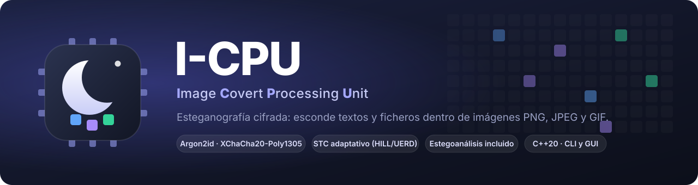

# Documentación de I-CPU

Toda la documentación del proyecto, organizada en **guías** (cómo usarlo) y **documentación técnica**
(cómo funciona y por qué). Si no sabes por dónde empezar, mira [¿Para quién es I-CPU?](guias/perfiles.md).

## Empezar

| | |
| --- | --- |
| [Instalación](guias/instalacion.md) | Ejecutables ya compilados o compilar en Windows, Linux y macOS. Problemas frecuentes. |
| [Primeros pasos](guias/primeros-pasos.md) | Tu primer mensaje oculto en 5 minutos, con capturas. |
| [¿Para quién es I-CPU?](guias/perfiles.md) | Rutas de lectura para usuarios, estudiantes, docentes, investigadores, desarrolladores y auditores. |

## Guías de uso

| | |
| --- | --- |
| [Interfaz gráfica](guias/interfaz-grafica.md) | Las cuatro pestañas, opciones avanzadas, historial, atajos y cierre. |
| [Línea de comandos](guias/linea-de-comandos.md) | Referencia completa de `icpu`, modo guiado, códigos de salida y automatización. |
| [Buenas prácticas](guias/buenas-practicas.md) | Qué imagen usar, cuánto ocultar, la contraseña y cómo enviarla sin destruir el mensaje. |
| [Experimentos](guias/experimentos.md) | Reproducir las figuras, interpretar los resultados y diseñar experimentos propios. |

## Documentación técnica

| | |
| --- | --- |
| [Arquitectura](tecnico/arquitectura.md) | Capas, portadoras, el camino de un mensaje, errores, límites y rendimiento. |
| [Esteganografía](tecnico/esteganografia.md) | Dominios, modos de escritura, costes y Syndrome-Trellis Codes. |
| [Criptografía y amenazas](tecnico/criptografia.md) | Primitivas, derivación de claves, qué protege y frente a quién. |
| [Formato v3](tecnico/formato.md) | Especificación byte a byte de lo que queda en la imagen. |
| [Estegoanálisis](tecnico/estegoanalisis.md) | Chi-cuadrado, análisis RS, métricas y qué no detectan. |
| [Interfaz web y API HTTP](tecnico/interfaz-web.md) | Seguridad, ciclo de vida, rutas y frontend. |
| [Biblioteca C++](tecnico/biblioteca.md) | Integrar I-CPU en otro programa. |
| [Calidad, pruebas y desarrollo](tecnico/calidad-y-pruebas.md) | Compilación, 68 pruebas, fuzzing, CI y estilo. |
| [Decisiones de diseño](tecnico/decisiones-de-diseno.md) | Por qué cada cosa es como es, y qué se descartó. |

## Referencia

| | |
| --- | --- |
| [Sobre el proyecto](sobre-el-proyecto.md) | El nombre, objetivos, evolución, lecciones aprendidas y trabajo futuro. |
| [Preguntas frecuentes](preguntas-frecuentes.md) | Respuestas cortas a las dudas habituales. |
| [Glosario](glosario.md) | Todos los términos técnicos, de AEAD a XChaCha20. |
| [Ilustraciones](ilustraciones.md) | Prompts para generar las ilustraciones decorativas con IA. |
| [CHANGELOG](../CHANGELOG.md) · [SECURITY](../SECURITY.md) · [CONTRIBUTING](../CONTRIBUTING.md) | Cambios por versión, política de seguridad y cómo contribuir. |

## Figuras

Todas las imágenes están en [`img/`](img/):

| Carpeta | Contenido | Cómo se genera |
| --- | --- | --- |
| `img/marca/` | banner y explicación del nombre | SVG a mano |
| `img/diagramas/` | arquitectura, flujos, formato, dominios, modos, seguridad, ciclo de vida, amenazas | SVG a mano, con tema claro y oscuro |
| `img/experimentos/` | gráficas y figuras de resultados, `resultados.json` | `node scripts/generar_figuras.mjs` |
| `img/gui/` | capturas de la interfaz en tema claro y oscuro | `node scripts/generar_figuras.mjs --capturas` |
| `img/ilustraciones/` | ilustraciones decorativas (opcionales) | con IA, ver [prompts](ilustraciones.md) |
