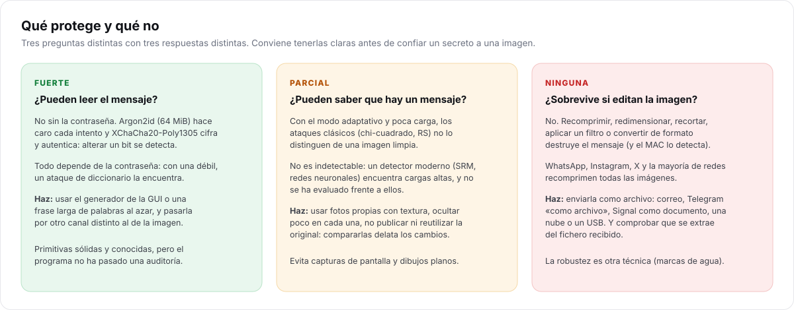
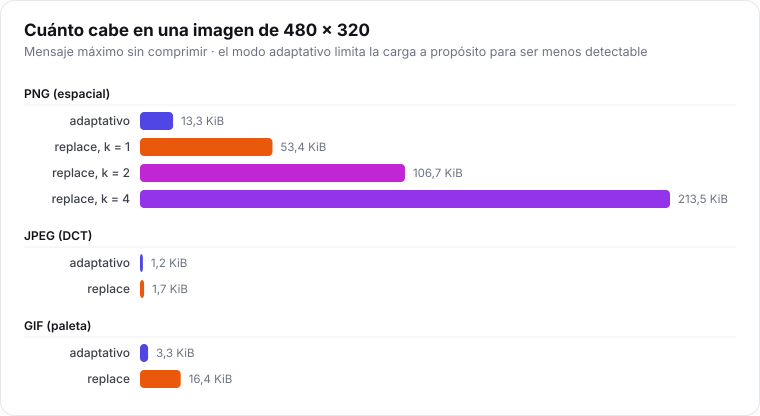

# Buenas prácticas

> **Para quién:** quien vaya a usar I-CPU con un secreto de verdad. Son las decisiones que más
> influyen en la seguridad, por encima de cualquier opción técnica.

## Lista rápida

- [ ] Uso una **foto propia** con textura (no una descargada de Internet ni una captura de pantalla).
- [ ] Oculto **poco**: dejo el modo adaptativo y, si no cabe, uso una foto más grande o comprimo el fichero.
- [ ] La **contraseña** es larga y aleatoria, y la comparto por **otro canal** distinto al de la imagen.
- [ ] Envío la imagen **como archivo**, nunca como foto en una red social o en WhatsApp.
- [ ] **Borro la original** (o no la comparto nunca) y no reutilizo la misma portadora.
- [ ] El receptor ha comprobado que puede extraer el mensaje del fichero que recibió.

## Elegir la imagen

| Mejor | Peor | Por qué |
| --- | --- | --- |
| Fotos con textura: vegetación, arena, tela, gente, ciudad | Cielo despejado, paredes lisas, fondos de un color | El modo adaptativo esconde los cambios en la textura; en zonas lisas no tiene dónde. I-CPU avisa si la imagen es casi toda lisa. |
| Fotos **propias**, nunca publicadas | Imágenes de Internet | Quien encuentre la original en Internet puede compararlas píxel a píxel. |
| Tamaño grande (varios megapíxeles) | Miniaturas | Más capacidad con la misma carga relativa (y la carga baja es lo que hace difícil detectarlo). |
| JPEG de cámara o PNG sin editar | Capturas de pantalla, dibujos, logotipos | Las imágenes sintéticas tienen estadísticas muy regulares: cualquier cambio destaca. |
| El mismo formato que se suele enviar en tu entorno | Un formato raro | Un BMP de 30 MB llama más la atención que un JPEG de móvil. |

**¿PNG o JPEG?** PNG admite mucho más mensaje. Un JPEG pasa más desapercibido si es lo que suele
circular, pero cabe poco (unos pocos KB por foto). Si la portadora es JPEG, conviértela solo si es
necesario: I-CPU trabaja sobre sus coeficientes **sin recomprimirla**.

## Cuánto ocultar

La detectabilidad depende sobre todo de la **carga relativa** (bits por muestra), no del tamaño
absoluto del mensaje. El modo adaptativo la limita a 0,25 bits por ranura cambiable, una cota
prudente. Para ir más allá:

1. **Comprime** el fichero antes (`.zip`, `.7z`): I-CPU ya comprime, pero un compresor dedicado puede
   hacerlo mejor con algunos formatos.
2. Usa una **imagen más grande**, o reparte el contenido entre **varias imágenes**.
3. Solo como último recurso, `--mode replace`: cabe hasta 16 veces más, pero los tests clásicos lo detectan.

## La contraseña

- **Larga y aleatoria**: el botón ✦ de la GUI genera 20 caracteres al azar en grupos de cinco
  (`xK7mP-…`), unos 115 bits de entropía, sin caracteres confusos como 0/O o 1/l. Una frase de 6 palabras
  al azar también sirve.
- **Nunca** en la misma conversación que la imagen. Si alguien intercepta las dos cosas, el cifrado
  no sirve de nada. Díctala en persona, por llamada, o usa otro servicio de mensajería.
- **Una por destinatario** o por conversación, no la misma para todo.
- **No la reutilices** de otras cuentas.
- Si la pierdes, el mensaje se pierde: no hay forma de recuperarlo.

## Enviar la imagen

Cualquier cambio en el fichero destruye el mensaje: recomprimir, redimensionar, recortar, convertir,
quitar metadatos con algunos programas, «mejorar» la foto…

| Seguro (archivo tal cual) | Destruye el mensaje |
| --- | --- |
| Correo como adjunto | WhatsApp, Instagram, Facebook, X: como foto |
| Telegram → *Archivo* | Telegram → *Galería* (foto comprimida) |
| WhatsApp → *Documento* | Editores de fotos, filtros |
| Signal como archivo | Capturas de pantalla de la imagen |
| Nube (Drive, OneDrive, Dropbox), USB | Servicios que «optimizan» imágenes |

## Después de enviarla

- **Borra la original** o guárdala donde nadie la relacione con la copia. Compararlas revela qué
  píxeles cambiaron (aunque no el contenido).
- **No reutilices la portadora** para otro mensaje: dos versiones de la misma foto con pequeñas
  diferencias son sospechosas.
- **Cuidado con los metadatos**: I-CPU conserva los de la original (EXIF, ICC, comentarios) en PNG y JPEG. Si la foto lleva tu
  ubicación GPS o el modelo de tu móvil, quítalos *antes* de ocultar, nunca después (eso
  modificaría el fichero y borraría el mensaje).

## Imágenes de versiones anteriores

Las imágenes creadas con I-CPU 1.0 o 1.5 se siguen pudiendo extraer, pero sus formatos tenían
debilidades (posiciones repetidas, cabecera reconocible). Si el mensaje sigue siendo sensible,
**extráelo y vuelve a ocultarlo** con la 2.0 en una foto nueva.

## Usos que no son para I-CPU

- **Marcas de agua o prueba de autoría**: el mensaje no resiste ninguna edición.
- **Copias de seguridad**: usa cifrado de ficheros normal (VeraCrypt, 7-Zip con AES, age).
- **Cuando la detección pone en peligro a alguien**: I-CPU no se ha evaluado frente a detectores
  modernos ni ha pasado una auditoría. No confíes en él para proteger a personas.

Y, por supuesto, úsalo de forma legal y responsable: ocultar información no da permiso para
compartir lo que no puedes compartir.
