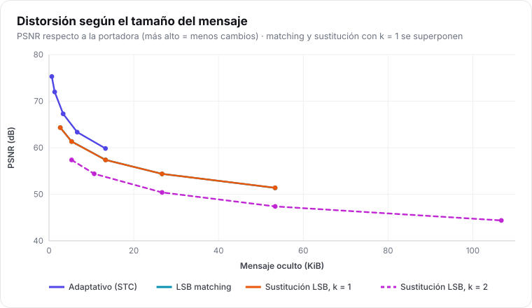
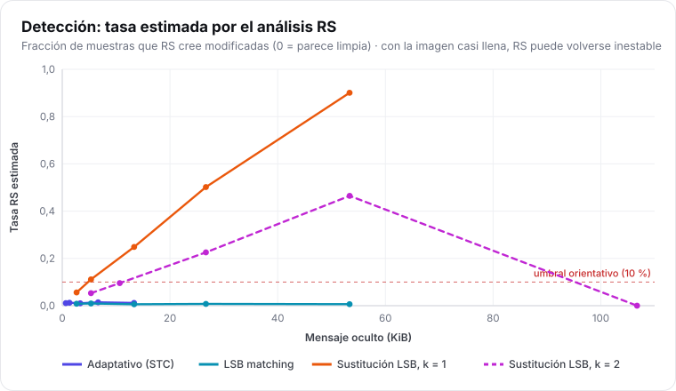
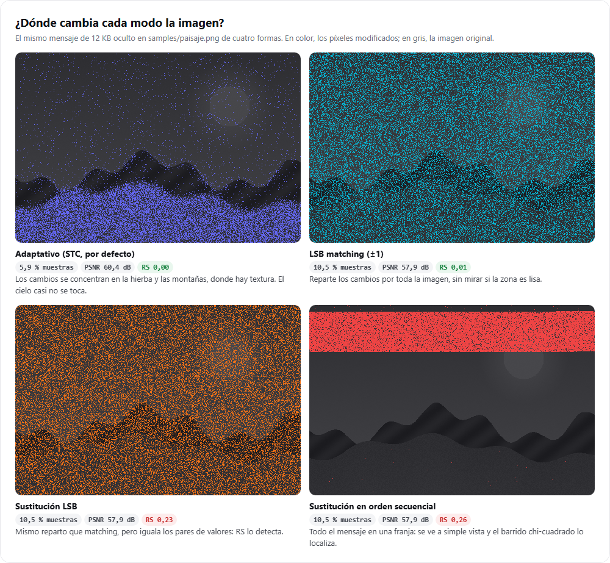
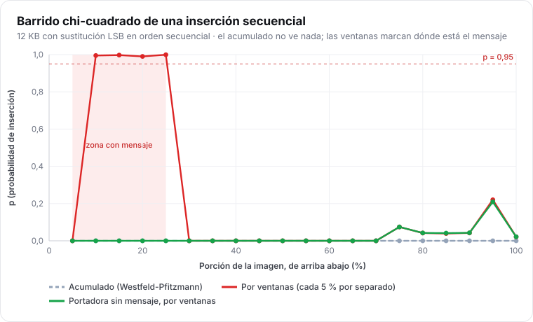

# Guía de experimentos

> **Para quién:** estudiantes, docentes e investigadores que quieran medir con I-CPU, reproducir las
> figuras de esta documentación o diseñar experimentos propios.

I-CPU incluye un banco de pruebas: oculta mensajes **aleatorios** (que no se pueden comprimir) con
cada combinación de parámetros y mide la distorsión y lo que ven los detectores clásicos.

## 1. Reproducir las figuras de la documentación

```bat
scripts\build.bat
node scripts\generar_figuras.mjs
```

Ejecuta tres experimentos (PNG, JPEG y GIF), oculta el mismo mensaje de 12 KB con cada modo y genera
en `docs/img/experimentos/` las gráficas SVG, las figuras PNG y `resultados.json` con todas las
cifras. Tarda unos 15 segundos. Requisitos: Node.js 22+ y Edge o Chrome.

Como cada inserción usa una sal y un nonce nuevos, las cifras varían ligeramente de una ejecución a
otra; las conclusiones, no.

## 2. Hacer un experimento propio

### Con la GUI

Pestaña **Experimento** → portadora → parámetros → **Ejecutar**. Exporta la tabla a CSV y cada
gráfica a PNG ([guía de la GUI](interfaz-grafica.md#experimento)).

### Con la CLI

```bat
icpu bench mifoto.png --bits 1,2 --modes adaptive,replace,match --layouts random --csv mifoto.csv
experiments\run_bench.bat mifoto.png      &rem los tres dominios, CSV en experiments\output\
```

### Con la biblioteca

`icpu::bench()` da los mismos datos como estructuras C++ ([ejemplo](../tecnico/biblioteca.md#analizar-y-experimentar)).

## 3. Qué se mide

| Columna | Significado | Mejor |
| --- | --- | --- |
| `llenado` | fracción de la capacidad **del modo** (el 100 % adaptativo es el 25 % de `replace` k = 1) | — |
| `bytes` | tamaño del mensaje aleatorio | — |
| `ranuras_cambiadas` | fracción de ranuras útiles modificadas | bajo |
| `psnr`, `ssim` | distorsión respecto a la portadora | alto |
| `chi2_p` | test chi-cuadrado sobre toda la imagen | bajo |
| `rs_tasa` | fracción estimada por el análisis RS | bajo (≈ la de la portadora) |
| `dct_chi2_p` | chi-cuadrado sobre coeficientes DCT (JPEG) | bajo |
| `segundos` | tiempo de la inserción (con Argon2id reducido) | — |

`−1` significa «no aplica en este dominio». La fila de referencia (*baseline*) es la portadora sin
mensaje: compara siempre con ella.

> **Para comparar modos, usa el tamaño del mensaje (`bytes`), no el llenado.** El 50 % adaptativo y
> el 50 % de sustitución son mensajes de tamaños muy distintos.

## 4. Resultados de referencia

Portadora `samples/paisaje.png` (480 × 320, sintética con ruido). Los datos completos están en
[`resultados.json`](../img/experimentos/resultados.json).

### Distorsión



- El **adaptativo** consigue el PSNR más alto con el mismo mensaje: STC cambia menos muestras
  (~5,9 % frente a ~10,5 % con 12 KB).
- **Matching** y **sustitución** con k = 1 distorsionan lo mismo: cambian el mismo número de muestras
  en la misma cantidad (±1). Lo que los distingue es *cómo* cambian, no *cuánto*.
- Con **k = 2** la distorsión sube mucho más deprisa.

### Detección



- **RS detecta la sustitución** casi en proporción a la carga: con 13 KB ya pasa del 25 %.
- **Matching y adaptativo** se quedan en el nivel de la portadora limpia (≈ 0,01): RS no los ve.
- Eso **no** significa que sean indetectables: RS busca la huella de la sustitución. Para matching
  y adaptativo hacen falta detectores modernos ([qué no detecta este análisis](../tecnico/estegoanalisis.md#6-qué-no-detecta-este-análisis-y-qué-sí-lo-haría)).

### Dónde se esconde



La diferencia clave del modo adaptativo: los cambios van a la hierba y a las montañas, y el cielo
liso queda casi intacto. Matching y sustitución los reparten por igual, también en el cielo, donde
un detector que mire la relación entre píxeles vecinos los encontraría.

### Inserción secuencial



### JPEG y GIF

| Dominio | Modo | Mensaje (100 %) | PSNR | Observación |
| --- | --- | --- | --- | --- |
| JPEG (DCT) | adaptativo | 1,2 KB | ≈ 37,3 dB | el PSNR lo domina la compresión JPEG, no el mensaje |
| JPEG (DCT) | sustitución | 1,7 KB | ≈ 36,9 dB | χ² DCT ≈ 0: los pares simétricos no dejan la huella de JSteg |
| GIF (paleta) | adaptativo | 3,3 KB | ≈ 35,2 dB | con una paleta de cubo 6×7×6, los colores vecinos distan ~43 niveles |
| GIF (paleta) | sustitución | 16,4 KB | ≈ 23,9 dB | con paletas adaptativas de fotos reales la distorsión es mucho menor |

## 5. Diseñar un buen experimento

1. **Varias imágenes.** Una sola portadora no basta para sacar conclusiones: usa un conjunto (por
   ejemplo, [BOSSbase](http://agents.fel.cvut.cz/boss/) o fotos propias variadas) y da medias y dispersión.
2. **Mismo tamaño de mensaje** al comparar modos.
3. **Mensajes aleatorios**, como hace `bench`: un texto comprimible daría una carga menor de la que parece.
4. **Separa entrenamiento y prueba** si usas un detector con aprendizaje.
5. **Informa de todo**: versión de I-CPU (`icpu version`), parámetros y semillas, para que se pueda reproducir.
6. **No confundas distorsión con detectabilidad**: un PSNR alto no implica que sea indetectable.

## 6. Ideas para trabajos y prácticas

- Medir cómo cambia la detección con la **textura** de la imagen (cielo frente a bosque).
- Comparar **HILL** con otra función de coste (S-UNIWARD, WOW) en el dominio espacial.
- Entrenar un detector **SRM + ensemble** sobre imágenes generadas con `bench` y medir su precisión
  para cada modo y carga.
- Estudiar el efecto de la **altura de STC** (h = 6, 8, 10) en distorsión y tiempo.
- Evaluar la **robustez**: qué calidad de recompresión JPEG soporta el mensaje (spoiler: ninguna).
