# Guía de la interfaz gráfica

> **Para quién:** quien prefiera usar I-CPU con el ratón. Cubre las cuatro pestañas, las opciones
> avanzadas, el historial, los atajos y cómo se cierra.

`icpu-gui.exe` abre I-CPU en el navegador. Todo ocurre **en tu equipo**: la página la sirve el propio
programa desde 127.0.0.1, no carga nada de Internet y ninguna imagen ni contraseña sale del
ordenador ([por qué es seguro](../tecnico/interfaz-web.md#seguridad)).

| Tema claro | Tema oscuro |
| --- | --- |
| 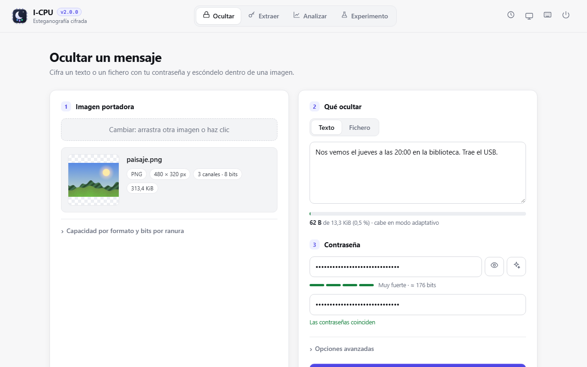 | 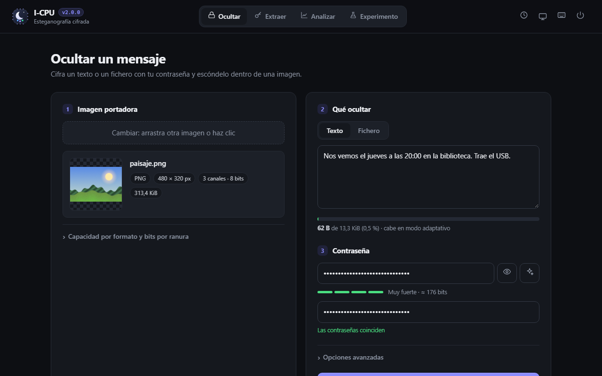 |

## Arrancar

```bat
icpu-gui.exe                 &rem abre el navegador en un puerto libre
icpu-gui.exe --port 8080     &rem puerto fijo
icpu-gui.exe --no-browser    &rem no abre el navegador: copia el enlace de la consola
```

El enlace de la consola termina en `#t=…`: es el **token de sesión**, que impide que otras webs usen
I-CPU. Si abres la dirección sin él, la web no funcionará.

Si `icpu-gui` ya está abierto, ejecutarlo otra vez **no** arranca un segundo servidor: abre otra
pestaña del que ya existe (en Windows).

## La cabecera

- **Logo y versión**: al pulsarlos se abre *Acerca de*, con el significado del nombre.
- **Pestañas**: Ocultar, Extraer, Analizar y Experimento (`Alt+1…4`).
- **Historial** (reloj, `Alt+H`), **tema** (sol/luna/monitor: claro, oscuro o automático),
  **atajos** (teclado, `?`) y **apagado**.

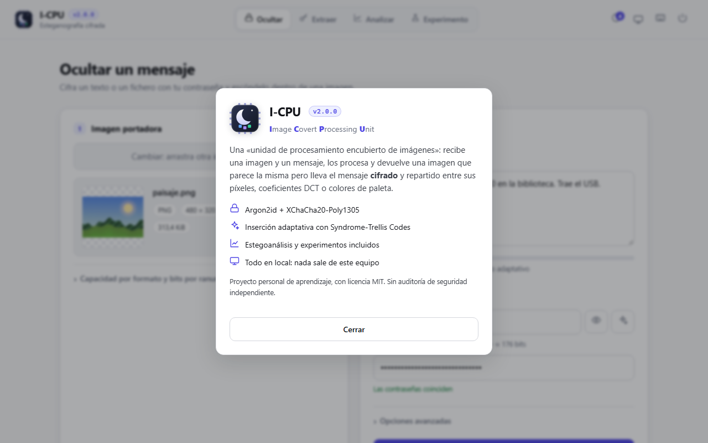

## Ocultar

1. **Imagen portadora.** Arrastra, pega (`Ctrl+V`) o elige una imagen. Se aceptan PNG, JPEG, GIF,
   BMP, TGA, QOI, PNM, PSD y HDR. Despliega *Capacidad por formato y bits por ranura* para ver
   cuánto cabe en cada formato de salida.
2. **Qué ocultar.** *Texto* o *Fichero* (cualquier tipo; se recupera con su nombre). El medidor
   indica la capacidad usada en el modo elegido y avisa si no cabe.
3. **Contraseña.** El ojo la muestra, ✦ genera una aleatoria segura y el medidor estima su fuerza
   en bits. Hay que escribirla dos veces.
4. **Opciones avanzadas** (plegadas; los valores por defecto son los recomendados):

   | Opción | Por defecto | Para qué |
   | --- | --- | --- |
   | Formato de salida | igual que la portadora | Elegir PNG, JPEG, GIF, BMP… El formato decide el [dominio](../tecnico/esteganografia.md#2-dominios). |
   | Modo | Adaptativo | *Sustitución* o *Matching* caben más, pero son más detectables ([modos](../tecnico/esteganografia.md#3-modos-de-escritura)). |
   | Bits por ranura | automático | Solo con sustitución: 1 a 4. |
   | Orden | aleatorio | *Secuencial* solo para experimentos: se detecta enseguida. |
   | Calidad JPEG | 90 | Solo si hay que convertir a JPEG una imagen que no lo es. |
   | Comprimir | sí | Comprime el mensaje antes de cifrarlo, si reduce. |

5. **Ocultar mensaje** (`Ctrl+Enter`).

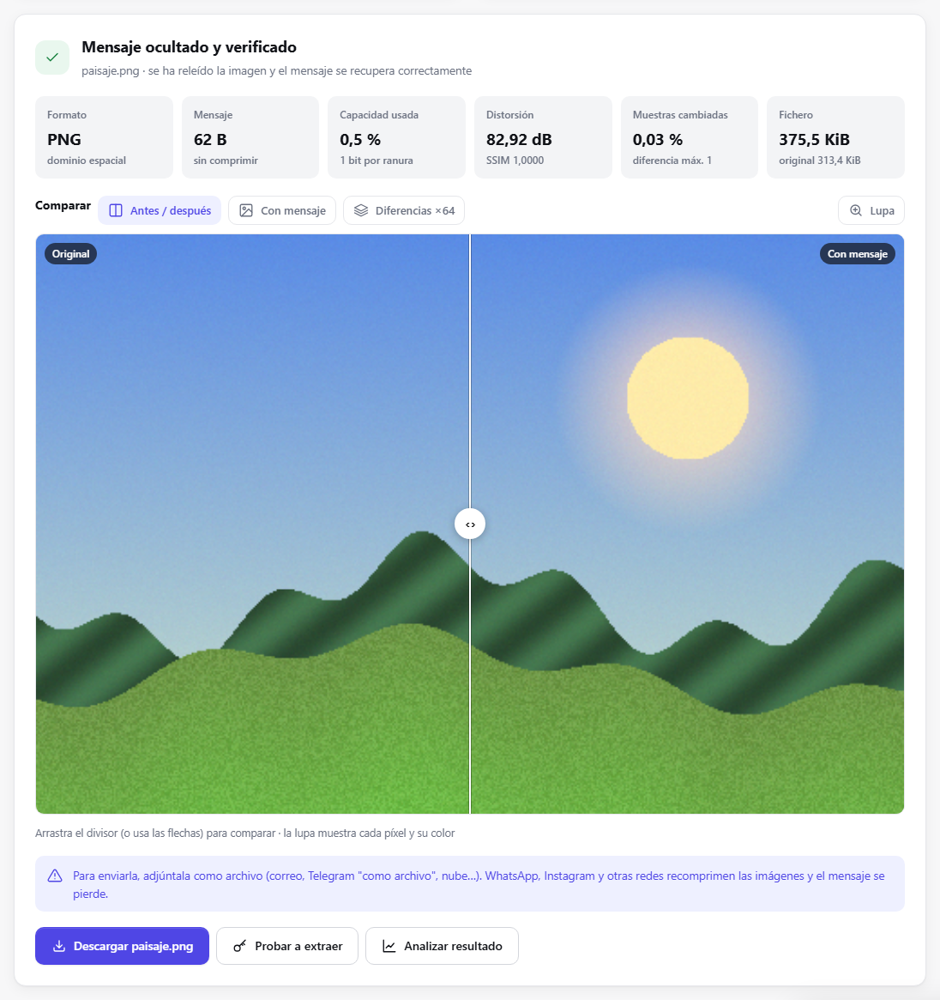

El resultado muestra:

- **Métricas**: formato y dominio, tamaño del mensaje (y si se comprimió), capacidad usada,
  distorsión (PSNR y SSIM), muestras cambiadas y tamaño del fichero.
- **Comparador**: *Antes/después* con divisor arrastrable (también con las flechas), *Con mensaje*
  y *Diferencias ×64*. La **lupa** muestra cada píxel con sus coordenadas y su color.
- **Avisos**: conversiones de formato, imagen casi toda lisa, fotogramas que se pierden, y cómo
  enviarla sin que se recomprima.
- **Descargar** (con el mismo nombre que la portadora), **Probar a extraer** y **Analizar resultado**.

## Extraer

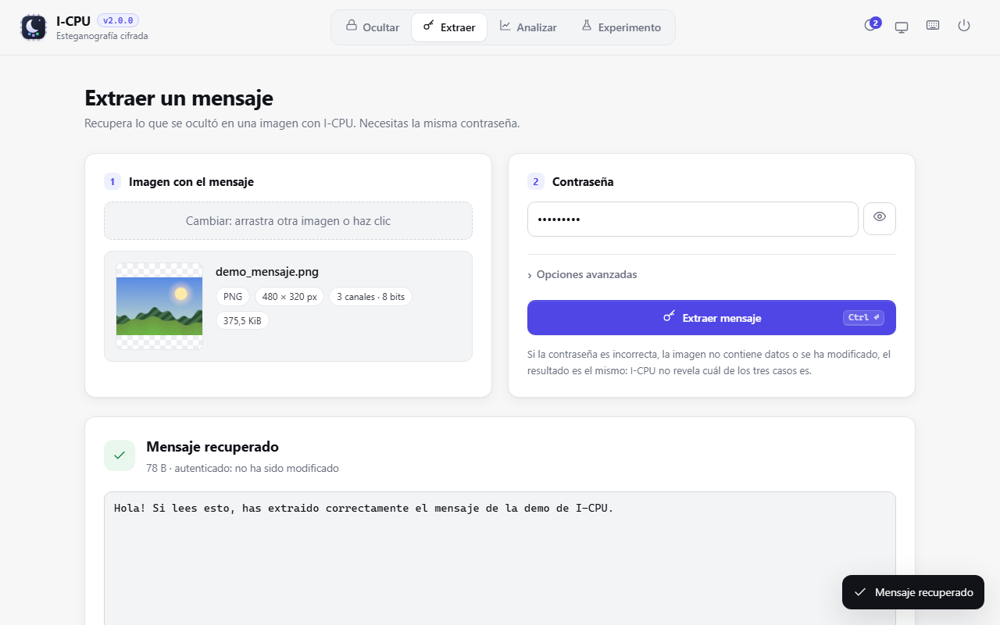

Arrastra la imagen, escribe la contraseña y pulsa **Extraer mensaje**. Si es un texto, se muestra
con botones para **copiarlo** o descargarlo como `.txt`; si es un fichero, se ofrece con su nombre
original. «Autenticado: no ha sido modificado» significa que el MAC coincide. *Opciones
avanzadas* solo tiene el orden, por si se ocultó en secuencial.

## Analizar

Estegoanálisis clásico: sirve para comprobar lo detectable que es una imagen y para aprender cómo
funcionan los ataques. La **portadora original** es opcional; si la das, también mide la distorsión.

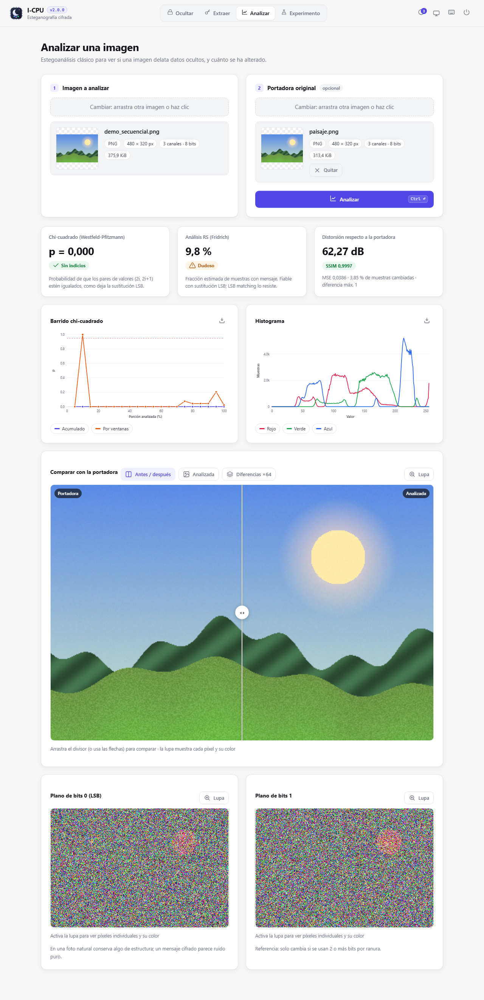

| Tarjeta | Qué dice | Más información |
| --- | --- | --- |
| Chi-cuadrado | p cercano a 1 = pares de valores igualados, como deja la sustitución LSB | [chi-cuadrado](../tecnico/estegoanalisis.md#2-test-chi-cuadrado-westfeld-y-pfitzmann-1999) |
| Análisis RS | fracción estimada de muestras modificadas | [RS](../tecnico/estegoanalisis.md#3-análisis-rs-fridrich-goljan-y-du-2001) |
| Distorsión | PSNR, SSIM y muestras cambiadas respecto a la original | [métricas](../tecnico/estegoanalisis.md#1-métricas-de-distorsión) |
| Barrido chi-cuadrado | curva **acumulada** y **por ventanas**; un pico en las ventanas señala dónde hay un mensaje secuencial | [barrido](../tecnico/estegoanalisis.md#barrido-chi-cuadrado) |
| Histograma | distribución de valores por canal | |
| Planos de bits | el bit 0 de una foto conserva algo de estructura; un mensaje cifrado lo vuelve ruido | |

En JPEG se aplica el chi-cuadrado sobre los coeficientes DCT en lugar de los tests de píxeles.

## Experimento

Oculta mensajes aleatorios en una portadora variando los parámetros, y mide distorsión y detección
de cada combinación. Es la herramienta para **comparar modos** con tus propias imágenes.

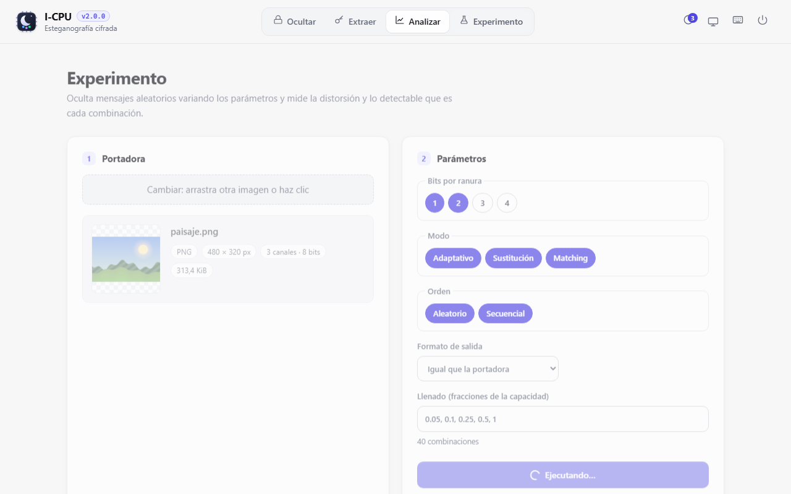

Elige bits por ranura, modos, órdenes, formato de salida y llenados (fracciones de la capacidad de
cada modo). El número de combinaciones se actualiza solo. Durante la ejecución se ve el progreso y
el tiempo restante.

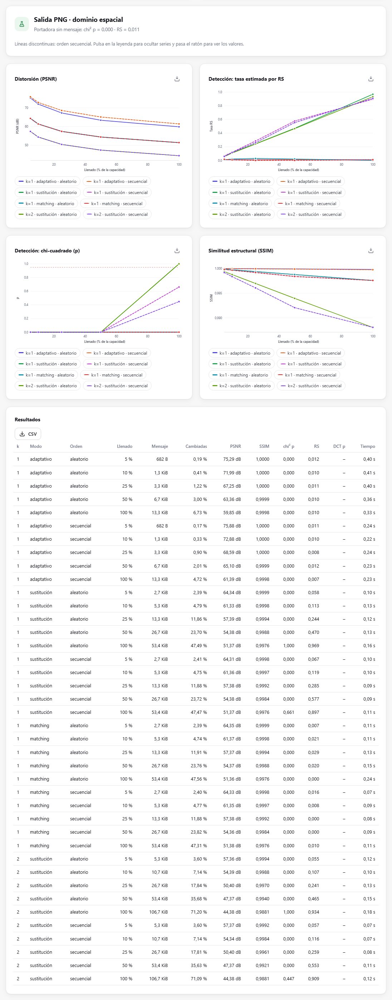

Las gráficas son interactivas: pulsa en la leyenda para ocultar series y pasa el ratón para ver los
valores. Cada una se exporta a PNG, y la tabla a **CSV**. Cómo interpretarlas: [guía de experimentos](experimentos.md).

## Historial

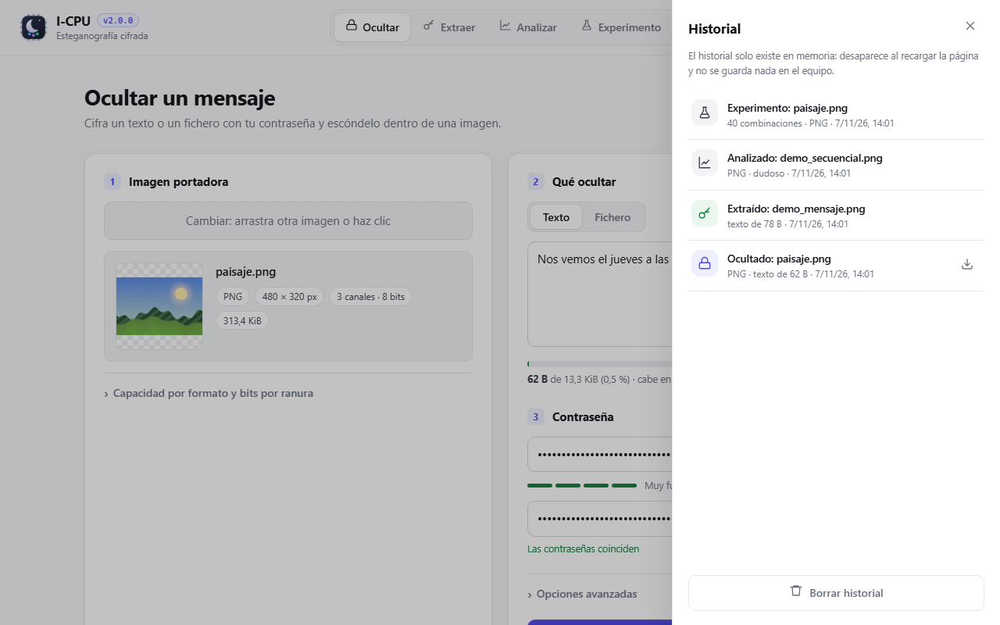

Lista las operaciones de la sesión (solo metadatos: nombres, tamaños, modo) con acceso a sus
descargas. **Vive solo en memoria**: al recargar la página desaparece, y no se guarda nada en el
equipo ni en el navegador.

## Atajos de teclado

| Atajo | Acción |
| --- | --- |
| `Ctrl+Enter` | ejecutar la acción de la pestaña |
| `Alt+1` … `Alt+4` | cambiar de pestaña |
| `Ctrl+V` | pegar una imagen del portapapeles |
| `Alt+H` | abrir o cerrar el historial |
| `?` | mostrar los atajos |
| `Esc` | cerrar paneles y diálogos |

También puedes **soltar un fichero en cualquier parte** de la ventana: va al recuadro de la pestaña activa.

## Cerrar I-CPU

| Forma | Qué pasa |
| --- | --- |
| Botón de apagado | Pide confirmación (y avisa si hay una operación en curso), detiene el servidor, cierra la consola e intenta cerrar la pestaña. |
| Cerrar todas las pestañas | El servidor se apaga solo a los ~10 s. Recargar la página no lo cierra. |
| `Ctrl+C` en la consola, o cerrar la consola | Se cierra al momento; las pestañas abiertas muestran «I-CPU se ha cerrado». |

| Confirmación | Después |
| --- | --- |
| 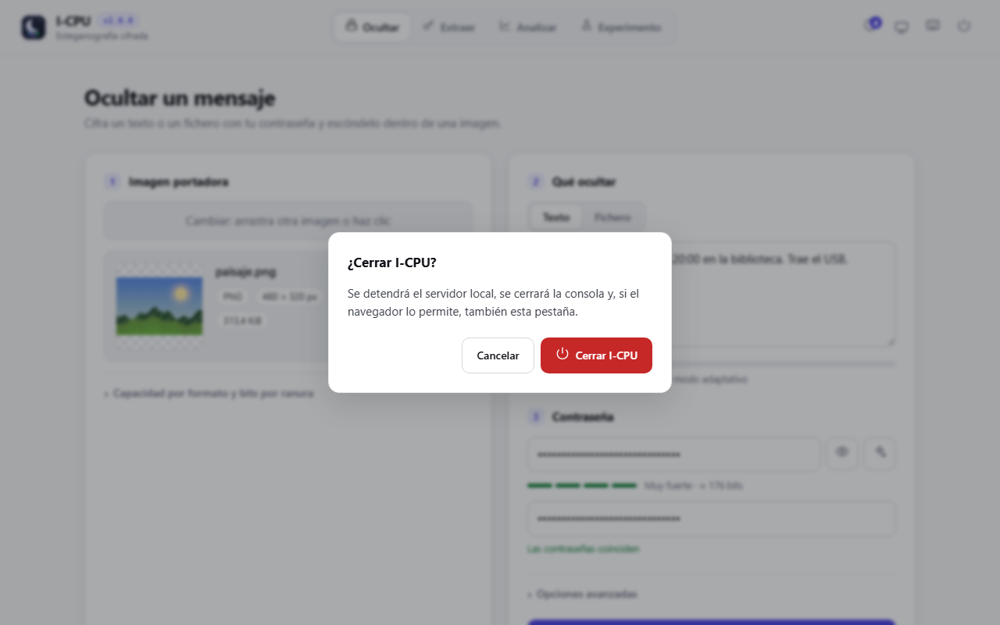 | 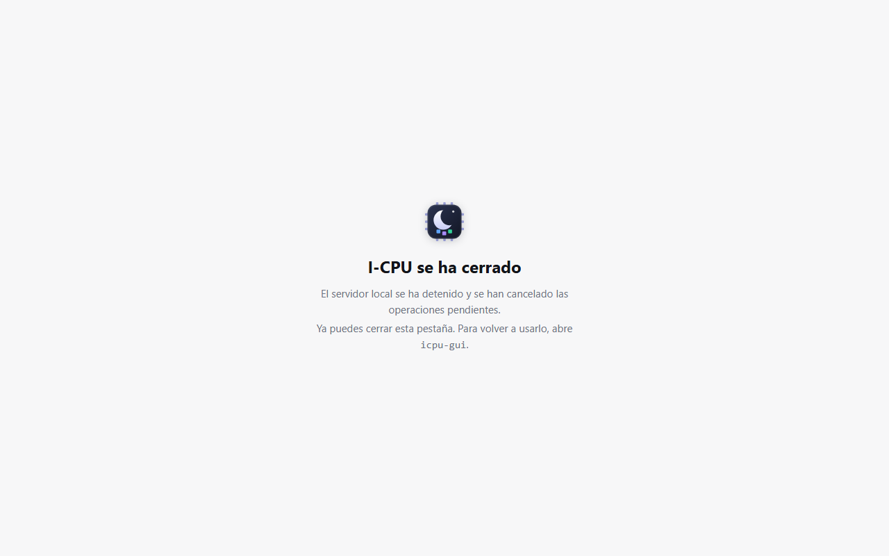 |

Si al cerrar había un experimento o una inserción larga en marcha, se cancela: el servidor no espera
más de 2 segundos.

## Problemas

| Problema | Solución |
| --- | --- |
| «Falta el token de sesión» | Abre el enlace completo de la consola, o vuelve a ejecutar `icpu-gui`. |
| «No hay conexión con I-CPU» | El servidor se ha cerrado: vuelve a ejecutar `icpu-gui`. |
| «No cabe en modo adaptativo» | Usa una imagen más grande, comprime el fichero, o elige *Sustitución* en las opciones avanzadas (más detectable). |
| «No se ha encontrado ningún mensaje» | Contraseña incorrecta, imagen sin mensaje o **recomprimida**: pide el fichero original. |
| La vista previa no aparece | QOI, TGA, PNM y PSD se muestran con una conversión interna; si falla, el resto funciona igual. |
