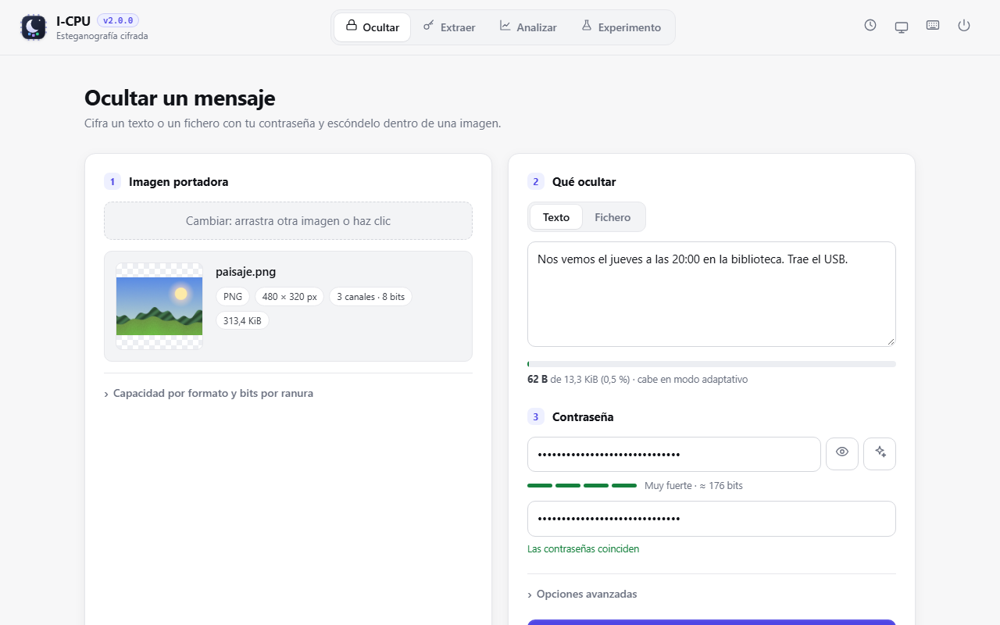
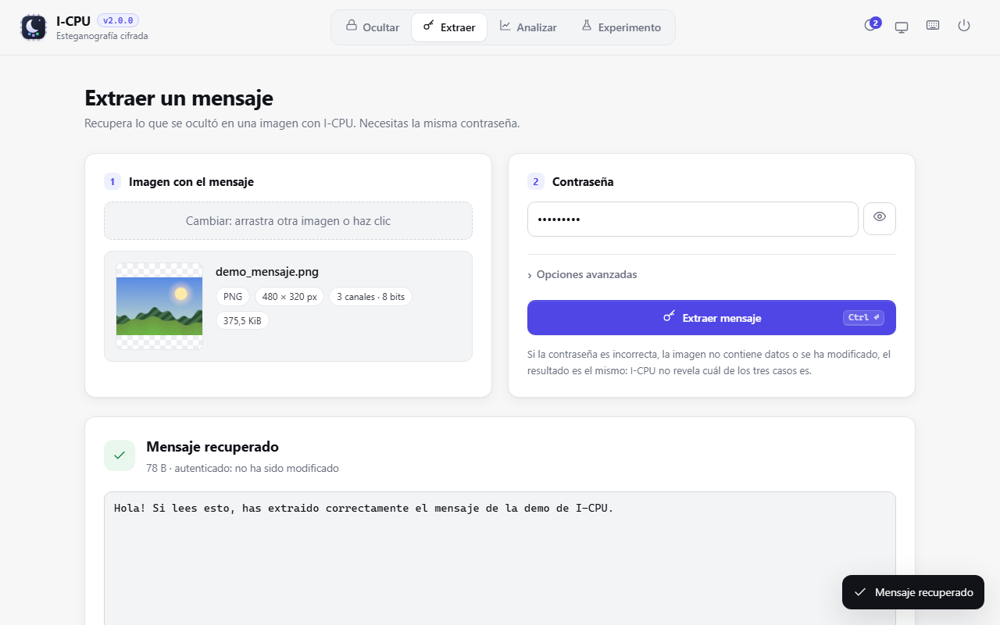

# Primeros pasos: tu primer mensaje oculto en 5 minutos

> **Para quién:** quien acaba de instalar I-CPU y nunca ha usado una herramienta de esteganografía.
> **Necesitas:** I-CPU ([instalación](instalacion.md)) y una foto tuya (o `samples\paisaje.png`).

Vas a hacer el recorrido completo: esconder un mensaje, comprobar que no se nota, recuperarlo y ver
qué pasa si la contraseña no es la correcta.

## 1. Abrir la interfaz

Haz doble clic en `icpu-gui.exe`. Se abre una consola (no la cierres: es el servidor) y el navegador
con I-CPU.



## 2. Ocultar

1. **Imagen portadora**: arrastra tu foto al recuadro 1, pégala con `Ctrl+V` o haz clic para
   elegirla. Verás su formato, tamaño y cuánto cabe.
2. **Qué ocultar**: escribe el mensaje en el recuadro 2 (o elige *Fichero*). La barra de abajo
   indica qué parte de la capacidad usas.
3. **Contraseña**: pulsa el botón ✦ para **generar** una contraseña segura, o escribe una frase
   larga. Repítela en el segundo campo.
4. Pulsa **Ocultar mensaje** (o `Ctrl+Enter`).

I-CPU cifra el mensaje, lo reparte por la imagen, relee el resultado y comprueba que se recupera.
Verás algo así:


Arrastra el divisor del comparador: las dos imágenes son iguales a simple vista. Pulsa
**Diferencias ×64** para ver dónde ha cambiado: solo en zonas con textura.

5. Pulsa **Descargar**. El fichero se llama como el original: nada en el nombre delata que lleva algo.

> Apunta la contraseña en un sitio seguro. **Sin ella, el mensaje no se puede recuperar**: no hay
> puerta trasera ni «recuperar contraseña».

## 3. Extraer

1. Ve a la pestaña **Extraer** (o `Alt+2`).
2. Arrastra la imagen que acabas de descargar y escribe la contraseña.
3. Pulsa **Extraer mensaje**.



Si era un fichero, aparece un botón para descargarlo con su nombre original.

## 4. Probar una contraseña incorrecta

Repite la extracción con otra contraseña. El error es:

> No se ha encontrado ningún mensaje: la contraseña es incorrecta, la imagen no contiene datos
> ocultos o ha sido modificada.

Es el mismo mensaje en los tres casos **a propósito**: si I-CPU dijera «la contraseña es
incorrecta», estaría confirmando que la imagen lleva algo.

## 5. Lo mismo desde la consola (opcional)

```bat
icpu embed foto.png -o foto_copia.png -m "Nos vemos a las 8"
icpu extract foto_copia.png
```

Las dos órdenes piden la contraseña sin mostrarla. Si ejecutas `icpu` sin nada, entra en un
**modo guiado** que pregunta paso a paso. Todo está en la [guía de la línea de comandos](linea-de-comandos.md).

## 6. Enviarla sin destruir el mensaje

Este es el error más habitual: **WhatsApp, Instagram, X y casi todas las redes recomprimen las
imágenes**, y eso borra el mensaje. Envíala **como archivo**:

| Canal | Cómo |
| --- | --- |
| Correo | adjunto normal |
| Telegram | clip → *Archivo* (no *Galería*) |
| WhatsApp | clip → *Documento* |
| Signal | adjuntar como archivo |
| Nube o USB | tal cual |

Y comprueba que el receptor puede extraerlo del fichero **que recibió**, antes de confiar en él.

## 7. Cerrar

Pulsa el botón de apagado (arriba a la derecha) o cierra la pestaña: I-CPU se cierra solo a los
pocos segundos. También vale `Ctrl+C` en la consola.

## Y ahora

- [Buenas prácticas](buenas-practicas.md): qué imágenes usar, cuánto ocultar y cómo compartir la contraseña.
- [Guía de la interfaz gráfica](interfaz-grafica.md): todas las opciones, el análisis y los experimentos.
- [Para quién es I-CPU](perfiles.md): rutas de lectura según lo que busques.
