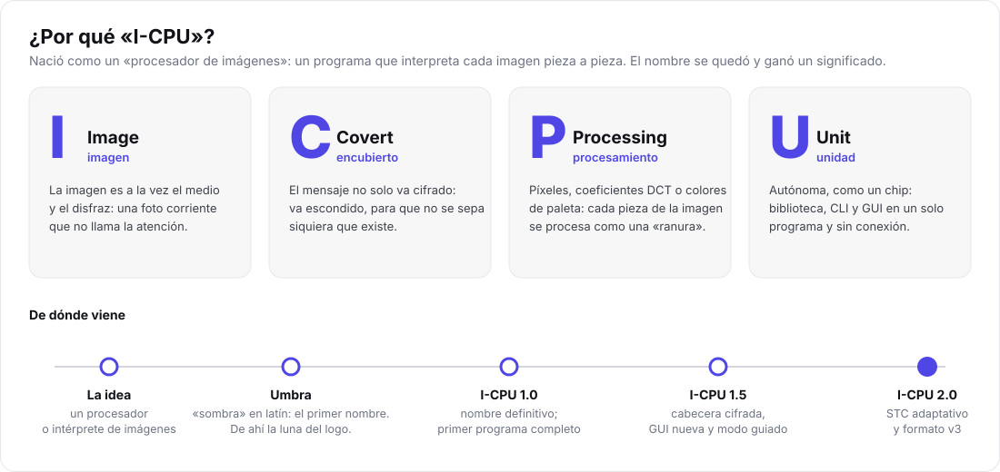

# Sobre el proyecto

> Qué es I-CPU, por qué existe, cómo ha evolucionado y qué se ha aprendido por el camino. Es la
> parte de «memoria» del proyecto: el contexto que no cabe en el código.

## Por qué «I-CPU»

El proyecto nació con una idea sencilla: un **procesador de imágenes**, un programa que
*interpreta* una imagen pieza a pieza (cada píxel, cada coeficiente, cada color de la paleta) y
puede reescribirla sin que cambie su aspecto. De ahí *CPU*: la imagen entra, se procesa y sale.

Durante un tiempo se llamó **Umbra** («sombra» en latín), por lo que hace: esconder algo a la sombra
de una imagen. De esa etapa queda la **luna** del logo. Al publicarlo recuperó el nombre de la idea
original, y el nombre ganó un significado propio:

| Letra | Palabra | Qué significa en el proyecto |
| --- | --- | --- |
| **I** | *Image* | La imagen es a la vez el medio y el disfraz. |
| **C** | *Covert* | Encubierto: el mensaje no solo va cifrado, va escondido. |
| **P** | *Processing* | Cada pieza de la imagen se procesa como una «ranura» donde cabe un bit. |
| **U** | *Unit* | Una unidad autónoma, como un chip: biblioteca, CLI y GUI, sin conexión a Internet. |

**I-CPU = Image Covert Processing Unit**, una unidad de procesamiento encubierto de imágenes. El
logo lo resume: la luna de Umbra sobre un chip, con tres píxeles de colores que son los datos escondidos.

## Objetivos

1. **Aprender haciendo**: implementar de principio a fin un sistema que combine criptografía,
   procesamiento de imagen, teoría de códigos y estadística, y no solo usar una biblioteca que lo haga.
2. **Hacerlo bien**: primitivas criptográficas conocidas, un formato especificado, pruebas,
   integración continua, fuzzing, y una documentación que explique cada decisión.
3. **Ser honesto con los límites**: medir lo detectable que es, y decir con claridad qué protege y qué no.
4. **Que lo pueda usar cualquiera**: una GUI que no exige saber nada de esteganografía y un modo
   guiado en la consola.

## Alcance

| Dentro | Fuera |
| --- | --- |
| Ocultar texto y ficheros en PNG, BMP, TGA, QOI, PNM, JPEG y GIF | Vídeo, audio, documentos |
| Cifrado autenticado con contraseña | Criptografía de clave pública (por ahora) |
| Inserción adaptativa (STC) y modos clásicos para comparar | Robustez frente a recompresión o edición |
| Estegoanálisis clásico y experimentos | Detectores modernos (SRM, redes neuronales) |
| Windows (principal) y Linux | Móvil |

## Evolución

| Versión | Fecha | Qué aportó |
| --- | --- | --- |
| **1.0** | 2026-10-30 | Biblioteca con tres dominios, Argon2id + XChaCha20-Poly1305, sustitución y matching, estegoanálisis, CLI y GUI web. 38 pruebas. |
| **1.5** | 2026-10-30 | Cabecera cifrada (v2), GUI rediseñada (comparador, lupa, medidores, generador de contraseñas, experimentos en vivo) y modo guiado. 46 pruebas. |
| **2.0** | 2026-10-31 → 11-07 | Formato v3 con sal aleatoria, **STC adaptativo por defecto**, límites de memoria, fuzzing y sanitizers en CI, ciclo de vida de la GUI, barrido χ² por ventanas y esta documentación. 68 pruebas. |

El detalle está en el [CHANGELOG](../CHANGELOG.md) y las razones en [Decisiones de diseño](tecnico/decisiones-de-diseno.md).

## Lo que se aprendió (y se corrigió)

Los fallos más instructivos del proyecto, todos con una prueba que impide que vuelvan:

- **Una sal derivada de la imagen repite posiciones.** Era una solución elegante a un problema
  circular, pero la misma imagen con la misma contraseña daba siempre las mismas posiciones, y
  compararlas delataba los datos. Lección: en criptografía, «determinista» suele ser sinónimo de
  «predecible» ([D7](tecnico/decisiones-de-diseno.md#d7-formato-v3-sal-aleatoria-guardada-en-la-imagen)).
- **Una restricción pequeña deja una huella grande.** Para proteger esa sal, el LSB matching no
  podía cruzar ciertas fronteras de valor, y el histograma quedó con un peine de periodo 16 que se
  veía a simple vista en una gráfica.
- **Lo seguro tiene que ser lo de por defecto.** La 1.5 usaba por defecto el modo más detectable y
  subía la carga sin avisar. En la 2.0, el modo por defecto es el más prudente y, si no cabe, falla
  y lo explica ([D8](tecnico/decisiones-de-diseno.md#d8-inserción-adaptativa-con-stc-por-defecto)).
- **Un fichero de 35 bytes puede pedir 1 GiB.** Un decodificador no puede fiarse de las dimensiones
  que declara la cabecera. El fuzzing encuentra este tipo de casos mejor que cualquier prueba escrita a mano.
- **Un error que se ignora es un error que miente.** El botón de apagado de la GUI mostraba «cerrado»
  cuando el servidor había rechazado la petición (un formulario vacío que cpp-httplib responde con
  400). Nadie lo notó en dos versiones porque el error se tragaba en silencio.
- **Mejorar una parte puede romper una herramienta de otra.** Escribir la cabecera con STC mejoró
  la indetectabilidad, y con ello el barrido chi-cuadrado clásico dejó de ver las inserciones
  secuenciales de la demo. La documentación seguía prometiendo lo contrario ([D9](tecnico/decisiones-de-diseno.md#d9-barrido-chi-cuadrado-acumulado-y-por-ventanas)).
- **Las imágenes sintéticas engañan.** Con un generador aleatorio simple, los bits bajos tenían
  periodos cortos y el estegoanálisis daba resultados absurdos ([D5](tecnico/decisiones-de-diseno.md#d5-imágenes-de-prueba-generadas-en-código)).

## Conocimientos que pone en práctica

| Área | Dónde |
| --- | --- |
| Criptografía aplicada: KDF, AEAD, separación de dominios, oráculos | `src/crypto`, `stego/engine` |
| Teoría de códigos: codificación por síndrome, trellis, Viterbi | `stego/stc` |
| Procesamiento de imagen: DCT, cuantización, paletas, filtros | `src/jpeg`, `src/gif`, costes HILL/UERD |
| Formatos binarios: PNG, QOI, PNM, GIF/LZW escritos a mano | `src/image`, `src/gif` |
| Estadística: chi-cuadrado, análisis RS, PSNR, SSIM | `src/analysis` |
| Programación concurrente | STC por segmentos, servidor HTTP, ciclo de vida |
| Seguridad web: CSP, CORS, DNS rebinding, tokens | `apps/gui` |
| Ingeniería del software: capas, pruebas, CI, fuzzing, sanitizers, versionado | todo el repositorio |

## Trabajo futuro

Por orden de interés:

1. **Evaluar frente a detectores modernos** (SRM + ensemble, redes neuronales) con un conjunto de
   imágenes reales, y ajustar la carga prudente con datos.
2. **Clave pública** (X25519): poder ocultar un mensaje para alguien sin compartir una contraseña.
3. **Fichero de clave** como alternativa a la contraseña.
4. **Mensaje señuelo** (negación plausible): dos contraseñas que revelan mensajes distintos.
5. **J-UNIWARD** en JPEG y **STC ternario**.
6. Un **modo robusto** frente a la recompresión JPEG (modulación QIM en coeficientes de baja
   frecuencia con corrección de errores), a costa de mucha menos capacidad.
7. **Firmar los ejecutables** de Windows para evitar los avisos de SmartScreen y Smart App Control.

## Créditos

- Autor: José Luis ([@jossseluuu](https://github.com/jossseluuu)).
- Bibliotecas: [Monocypher](https://monocypher.org/), [libjpeg-turbo](https://libjpeg-turbo.org/),
  [stb](https://github.com/nothings/stb), [cpp-httplib](https://github.com/yhirose/cpp-httplib) y
  [doctest](https://github.com/doctest/doctest). Licencias en el [README](../README.md#dependencias).
- Algoritmos: STC (Filler, Judas y Fridrich), HILL (Li et al.), UERD (Guo et al.), EzStego
  (Machado), análisis RS (Fridrich, Goljan y Du), chi-cuadrado (Westfeld y Pfitzmann). Referencias
  completas en [Esteganografía](tecnico/esteganografia.md#referencias) y [Estegoanálisis](tecnico/estegoanalisis.md#referencias).
