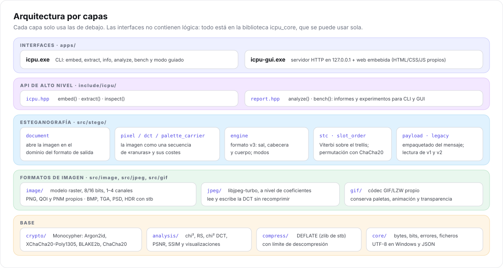
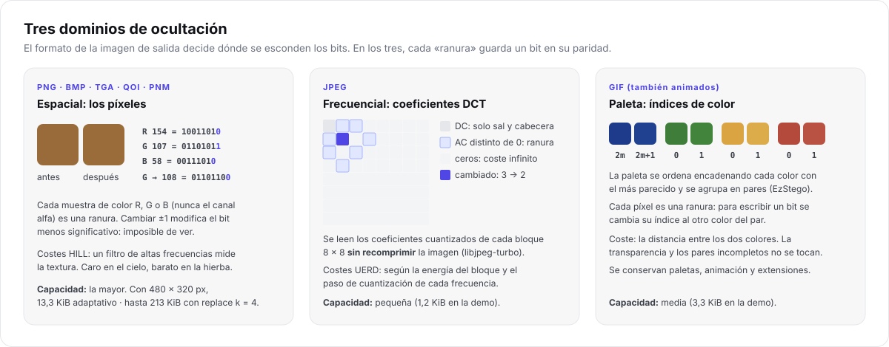
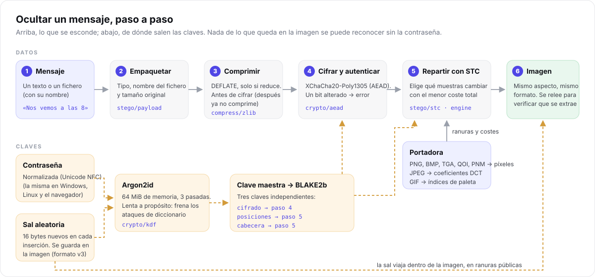
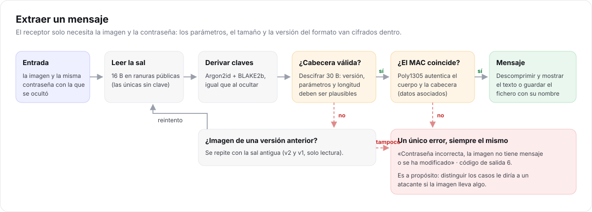

# Arquitectura

> **Para quién:** desarrolladores y estudiantes que quieran entender el código por dentro.
> **Requisitos previos:** C++ y una idea general de qué es la esteganografía (ver el [glosario](../glosario.md)).

Este capítulo recorre I-CPU desde fuera hacia dentro: las capas, la abstracción central (la
*portadora*), el camino que sigue un mensaje y dónde está cada cosa en el repositorio. Los detalles
de cada pieza tienen su propio capítulo: [formato](formato.md), [criptografía](criptografia.md),
[esteganografía](esteganografia.md), [estegoanálisis](estegoanalisis.md) e [interfaz web](interfaz-web.md).

## 1. Capas



| Capa | Carpeta | Responsabilidad | Depende de |
| --- | --- | --- | --- |
| Interfaces | `apps/cli`, `apps/gui` | Leer argumentos o peticiones HTTP y formatear resultados | API |
| API de alto nivel | `include/icpu/icpu.hpp`, `report.hpp` | `embed`, `extract`, `inspect`, `analyze`, `bench` | Esteganografía, análisis |
| Esteganografía | `src/stego` | Documento → portadora → motor; formato v3; STC | Formatos, base |
| Formatos | `src/image`, `src/jpeg`, `src/gif` | Píxeles, coeficientes DCT e índices de paleta | Base |
| Base | `src/crypto`, `src/compress`, `src/core`, `src/analysis` | Primitivas criptográficas, DEFLATE, utilidades, métricas | `third_party` |

Dos reglas mantienen el diseño ordenado:

1. **Las interfaces no tienen lógica.** Todo lo que hace la CLI lo puede hacer la GUI y al revés,
   porque ambas llaman a las mismas funciones. Por eso los informes de análisis y los experimentos
   viven en la biblioteca ([D4](decisiones-de-diseno.md#d4-análisis-y-experimentos-dentro-de-la-biblioteca)).
2. **El motor no sabe de formatos.** `stego/engine` trabaja con una abstracción, la *portadora*, y
   no sabe si debajo hay un PNG, un JPEG o un GIF.

## 2. La portadora: una secuencia de «ranuras»

Una portadora (`include/icpu/stego/carrier.hpp`) es una secuencia de N **ranuras**, cada una con
un valor cuyo bit bajo se puede leer y cambiar. Cada dominio la implementa a su manera:

| Dominio | Clase | Una ranura es… | Bits por ranura | Lo que no se toca |
| --- | --- | --- | --- | --- |
| Espacial | `PixelCarrier` | una muestra de color R, G, B o gris (nunca alfa) | 1–4 | nada |
| DCT | `DctCarrier` | un coeficiente cuantizado de un bloque 8×8 | 1 | 0 (y ±1 con `replace`); el DC solo lleva sal y cabecera |
| Paleta | `PaletteCarrier` | un píxel de cualquier fotograma | 1 | color transparente y colores sin pareja |



Toda portadora debe cumplir cuatro **invariantes**, porque el receptor tiene que «ver» exactamente
lo mismo que el emisor sin conocer el mensaje:

1. **Escribir no cambia qué ranuras son utilizables.** Por eso las exclusiones van por pares:
   cambiar el bit bajo nunca saca un valor de su par.
2. **Las ranuras reservadas** (sal y cabecera) no cambian de categoría con ningún modo: todas en
   espacial, los píxeles con pareja en paleta y los coeficientes DC en JPEG.
3. `read` devuelve lo último que se escribió, y `flip` invierte el bit que lee `read`.
4. `read` está definido en **todas** las ranuras, también en las que no se pueden cambiar: el
   receptor de STC lee la secuencia completa sin saber cuáles eran.

Las pruebas de `tests/test_stego.cpp` comprueban estas invariantes en los tres dominios.

### Documentos

Un *documento* (`stego/document.hpp`) abre una imagen en el dominio que corresponde al formato de
**salida** y sabe volver a guardarla:

| Salida | Dominio | Qué hace |
| --- | --- | --- |
| PNG, BMP, TGA, QOI, PNM | espacial | Decodifica y adapta la imagen al formato (por ejemplo, BMP no admite 16 bits), avisando de cada cambio |
| JPEG | DCT | Si la portadora ya es JPEG, lee sus coeficientes **sin recomprimir**; si no, la comprime una vez (calidad 90) y oculta después |
| GIF | paleta | Exige una portadora GIF; conserva paletas, animación y extensiones |

## 3. El camino de un mensaje



1. **Empaquetar** (`stego/payload`): `flags | longitud del nombre | nombre | tamaño original | datos`.
2. **Comprimir** con DEFLATE, solo si reduce el tamaño. Se hace *antes* de cifrar porque un texto
   cifrado no se puede comprimir.
3. **Cifrar** con XChaCha20-Poly1305: la cabecera va como dato asociado, así que el MAC la protege también.
4. **Planificar** (`stego/engine`): calcular W, las ranuras de la sal, las de la cabecera y las del cuerpo.
5. **Escribir** con STC (sal, cabecera y, en modo adaptativo, el cuerpo) o a k bits por ranura.
6. **Guardar** la imagen y, salvo `--no-verify`, **releerla** y extraer el mensaje para comprobar
   que todo cuadra antes de dar el resultado por bueno.

La extracción hace el camino inverso:



## 4. Mapa del repositorio

```text
include/icpu/        API pública
  icpu.hpp           embed(), extract(), inspect()
  report.hpp         analyze(), bench()
  stego/ image/ ...  cabeceras de cada módulo
src/                 implementación de la biblioteca icpu_core
  core/              bytes, bits, errores, ficheros (UTF-8 en Windows) y JSON
  crypto/            Argon2id, XChaCha20-Poly1305, BLAKE2b, ChaCha20, aleatorio del sistema
  compress/          DEFLATE con límite de descompresión
  image/             modelo raster; PNG, QOI y PNM propios; BMP, TGA, PSD, HDR y PIC con stb
  jpeg/              coeficientes DCT con libjpeg-turbo
  gif/               códec GIF/LZW propio
  stego/             portadoras, documento, orden de ranuras, STC, motor, carga útil y legado (v1, v2)
  analysis/          métricas, estegoanálisis y visualizaciones
apps/cli/            icpu.exe: un fichero por comando, ayuda y modo guiado
apps/gui/            icpu-gui.exe: servidor HTTP + web/ embebida al compilar
tests/               pruebas doctest; golden/ con imágenes reales de cada versión
fuzz/                objetivo libFuzzer para los decodificadores
scripts/             compilación, muestras, demos y figuras de la documentación
samples/             portadoras de ejemplo e imágenes de demostración
experiments/         script de experimentos (resultados en output/, ignorado por git)
docs/                esta documentación
third_party/         Monocypher, libjpeg-turbo, stb, cpp-httplib, doctest
```

## 5. Errores

Todos los fallos son excepciones `icpu::Error` con un código (`include/icpu/core/error.hpp`). Cada
interfaz los traduce a su manera:

| Código | Significado | CLI (salida) | GUI (HTTP) |
| --- | --- | --- | --- |
| `InvalidArgument` | opción o parámetro incorrecto | 2 | 400 |
| `Io` | no se puede leer o escribir un fichero | 3 | 500 |
| `UnsupportedFormat`, `CorruptData` | formato no soportado o dañado | 4 | 400 |
| `Capacity` | el mensaje no cabe | 5 | 400 |
| `Authentication` | contraseña incorrecta, sin mensaje o imagen alterada | 6 | 422 |
| `Internal` | error inesperado | 70 | 500 |

`Authentication` agrupa tres casos a propósito: distinguirlos le diría a un atacante si la imagen
lleva algo ([detalle](criptografia.md#un-solo-error)).

## 6. Límites de recursos

Una imagen puede venir de cualquier sitio, así que los decodificadores no se fían de lo que dice
la cabecera del fichero:

- **Dimensiones** (`include/icpu/image/limits.hpp`): como mucho 200 millones de píxeles por imagen o
  fotograma y 500 millones en total en un GIF animado. Antes de la 2.0, un GIF de 35 bytes podía
  pedir casi 1 GiB de memoria.
- **Descompresión** del mensaje con un tamaño máximo.
- **Subidas** a la GUI de hasta 256 MiB.

El objetivo de fuzzing (`fuzz/fuzz_decoders.cpp`) alimenta los decodificadores con datos
aleatorios en la CI, con AddressSanitizer y UndefinedBehaviorSanitizer ([pruebas](calidad-y-pruebas.md)).

## 7. Rendimiento

| Operación | Coste dominante | Orden de magnitud |
| --- | --- | --- |
| Derivar la clave | Argon2id, 64 MiB y 3 pasadas | ~0,5 s, a propósito |
| Modo adaptativo | Viterbi con 256 estados por elemento | ~4 s con 2 MP, ~24 s con 12 MP |
| `replace` y `match` | lineal en el número de ranuras | décimas de segundo |
| Extraer con contraseña incorrecta | Argon2id dos veces (sal nueva y antigua) | ~1 s |

STC se resuelve por segmentos de hasta 2²⁰ elementos en paralelo para limitar la memoria.

## 8. Limitaciones conocidas

- **Cualquier edición** de la imagen (recomprimir, redimensionar, recortar, convertir) destruye el mensaje.
- El estegoanálisis incluido es **clásico**: detectores modernos (SRM, redes neuronales) detectan
  cargas mucho menores, y el modo adaptativo no se ha evaluado frente a ellos.
- Quien tenga la **imagen original** puede compararla con la que lleva el mensaje.
- El modo adaptativo es **lento** en imágenes grandes.
- Las imágenes **v1 y v2** conservan sus debilidades: conviene volver a ocultar esos mensajes.
- El **análisis RS** se vuelve inestable con la imagen casi llena.
- La descompresión de stb falla con un flujo de 0 bytes; hoy no se alcanza, porque un mensaje
  vacío nunca se comprime.
- **Sin auditoría** de seguridad independiente.
