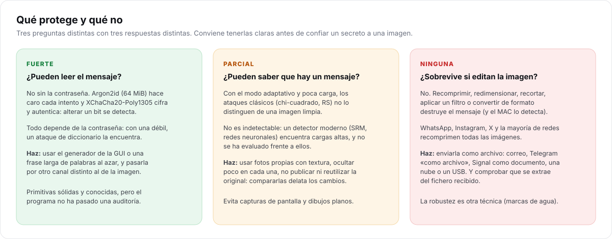

# Criptografía y modelo de amenazas

> **Para quién:** quien quiera saber qué garantiza I-CPU, frente a quién y con qué primitivas.
> No hace falta saber criptografía: cada sección empieza con la idea y termina con el detalle.

## Qué protege y qué no



I-CPU combina dos técnicas que responden a preguntas distintas:

- **Criptografía**: aunque alguien encuentre el mensaje, no puede leerlo ni modificarlo sin que se note.
- **Esteganografía**: intenta que nadie sepa siquiera que hay un mensaje.

La primera es fuerte y está construida con primitivas conocidas. La segunda es **parcial**: resiste
los ataques estadísticos clásicos, pero no está demostrada frente a detectores modernos. Y ninguna
de las dos hace que el mensaje sobreviva a una edición de la imagen.

## Adversarios considerados

| Adversario | Qué tiene | Qué consigue |
| --- | --- | --- |
| **Observador pasivo** | la imagen con el mensaje | Nada sin la contraseña. Con el modo adaptativo y poca carga, los tests clásicos no la distinguen de una limpia. |
| **Atacante de diccionario** | la imagen y mucho tiempo de cómputo | Probar contraseñas. Argon2id hace que cada intento cueste ~64 MiB y unas décimas de segundo. Con una contraseña fuerte, es inviable. |
| **Quien tiene la original** | la portadora y la imagen con mensaje | Saber que se modificó y dónde (comparando píxel a píxel). No puede leer el contenido. |
| **Atacante activo** | puede modificar la imagen | Destruir el mensaje (trivial), pero no cambiarlo: el MAC lo detecta. |
| **Web maliciosa** (GUI) | código JavaScript en otra pestaña | Nada: la API exige un token que no conoce ([interfaz web](interfaz-web.md#seguridad)). |
| **Malware en el equipo** | ejecución con tu usuario | Fuera del alcance: puede leer la memoria o el teclado. Ninguna aplicación protege de eso. |

## Primitivas

Todas vienen de [Monocypher 4](https://monocypher.org/), una biblioteca pequeña y auditada.

| Uso | Primitiva | Parámetros |
| --- | --- | --- |
| Derivar la clave | **Argon2id** | 64 MiB, 3 pasadas, 1 carril; sal de 16 B |
| Separar claves | **BLAKE2b** con clave | salida de 256 bits, etiquetas de dominio |
| Cifrar y autenticar | **XChaCha20-Poly1305** (AEAD) | nonce de 24 B aleatorio, MAC de 16 B |
| Cifrar la cabecera | **XChaCha20** | clave propia, mismo nonce |
| Orden de las ranuras | **ChaCha20** como generador | Fisher-Yates perezoso |
| Aleatoriedad | sistema operativo | `BCryptGenRandom` en Windows, `getrandom` en Linux |

## Derivación de claves

```text
sal_argon  = BLAKE2b("icpu/v3/salt/" ‖ dominio ‖ N ‖ sal almacenada)
maestra    = Argon2id(contraseña NFC, sal_argon, 64 MiB, 3 pasadas, ad = "icpu/v1/argon2id")
cifrado    = BLAKE2b(clave = maestra, "icpu/v1/encryption")
posiciones = BLAKE2b(clave = maestra, "icpu/v1/placement")
cabecera   = BLAKE2b(clave = maestra, "icpu/v2/header")
```

Por qué así:

- **Una sola ejecución de Argon2id** por inserción o extracción: es lo caro, y de la clave maestra
  salen tres claves independientes con un hash rápido.
- **Separación de dominios.** Cada clave tiene una etiqueta distinta, así que ninguna se reutiliza
  para dos fines. En particular, la cabecera y el cuerpo usan el mismo nonce con **claves
  distintas**: el par (clave, nonce) nunca se repite.
- **Sal aleatoria en cada inserción.** Ocultar dos veces en la misma imagen con la misma contraseña
  da claves y posiciones completamente distintas ([D7](decisiones-de-diseno.md#d7-formato-v3-sal-aleatoria-guardada-en-la-imagen)).
- **Dominio y N en la sal**: la misma sal en otra imagen o en otro dominio da otra clave.
- **Parámetros fijos.** Guardarlos en la imagen dejaría un valor reconocible. Subir el coste en el
  futuro exigirá una versión nueva del formato.

### La contraseña

- Se **normaliza a Unicode NFC** en Windows (`NormalizeString`) y en la web
  (`String.normalize`). Sin esto, «ñ» escrita como un carácter o como «n» + tilde combinada daría
  claves distintas. En Linux se usa tal cual llega, porque los terminales ya envían NFC.
- En Windows, la variable `ICPU_PASSWORD` se lee como UTF-16 y se convierte a UTF-8. Antes de la 2.0
  se leía en la página de códigos local, y una contraseña con tildes daba otra clave.
- Se acepta un fichero de contraseña con BOM UTF-8.
- La GUI incluye un **generador** (bits de entropía del sistema) y un medidor de fuerza.

**Qué contraseña usar.** Una frase de 5 o 6 palabras al azar, o una cadena aleatoria de 16 o más
caracteres. Con Argon2id a 64 MiB, un atacante con hardware dedicado puede probar del orden de miles
de contraseñas por segundo: una palabra del diccionario cae enseguida, una frase aleatoria no.

## Cifrado autenticado

El cuerpo se cifra con XChaCha20-Poly1305 y la cabecera descifrada va como **datos asociados**:

- Un bit cambiado en el cuerpo, en el nonce o en la cabecera hace fallar el MAC.
- El nonce de 24 bytes es aleatorio: con XChaCha20, la probabilidad de repetirlo es despreciable.
- Si el MAC falla, no se devuelve **nada**: ni siquiera los bytes descifrados.

## Un solo error

Con una contraseña incorrecta, una imagen sin mensaje y una imagen modificada, I-CPU devuelve **el
mismo error** (código 6, HTTP 422), con el mismo texto:

> No se ha encontrado ningún mensaje: la contraseña es incorrecta, la imagen no contiene datos
> ocultos o ha sido modificada.

Distinguir los casos sería un *oráculo*: le diría a un atacante si una imagen lleva algo. Por la
misma razón, la extracción prueba también las versiones antiguas del formato antes de rendirse.

## Lo que queda en la imagen

| Elemento | ¿Reconocible sin contraseña? |
| --- | --- |
| Sal (16 B, posiciones públicas) | No: cualquier imagen «tiene» un valor ahí (el síndrome de sus bits bajos), y en una foto parece ruido. |
| Nonce (24 B) | No: es aleatorio y está en posiciones secretas. |
| Versión, parámetros, longitud | No: van cifrados. |
| Cuerpo | No: es indistinguible de datos aleatorios. |
| Los **cambios** en la imagen | Sí, para quien tenga la original o un buen detector estadístico. |

## Limitaciones

- **Sin auditoría** independiente. Las primitivas son sólidas; la forma de combinarlas la ha
  revisado solo el autor.
- **Protección limitada de la memoria.** Los búferes sensibles (el área de trabajo de Argon2id, los
  flujos de claves, el texto descifrado si el MAC falla) se borran con `crypto_wipe`, pero la memoria
  no se bloquea: el sistema podría llevarla al fichero de paginación o a un volcado.
- **Sin cifrado de clave pública**: emisor y receptor comparten una contraseña. Intercambiarla por un
  canal seguro es responsabilidad del usuario.

Para informar de una vulnerabilidad, sigue la [política de seguridad](../../SECURITY.md).
