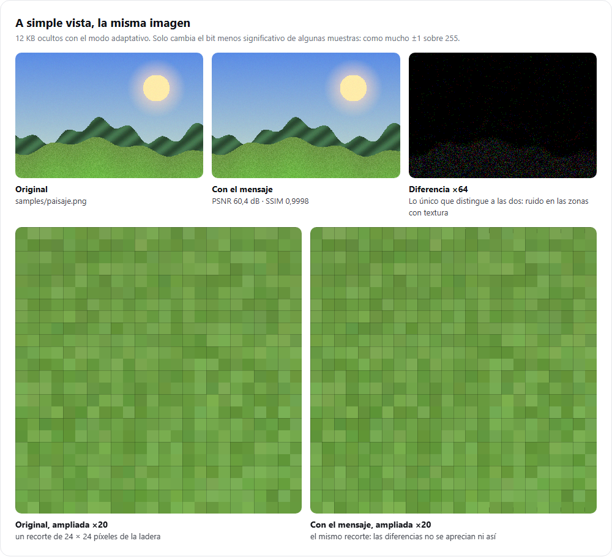
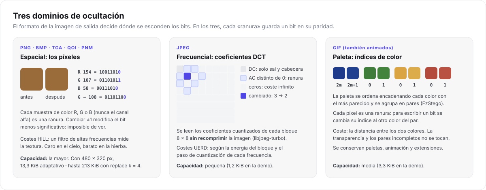
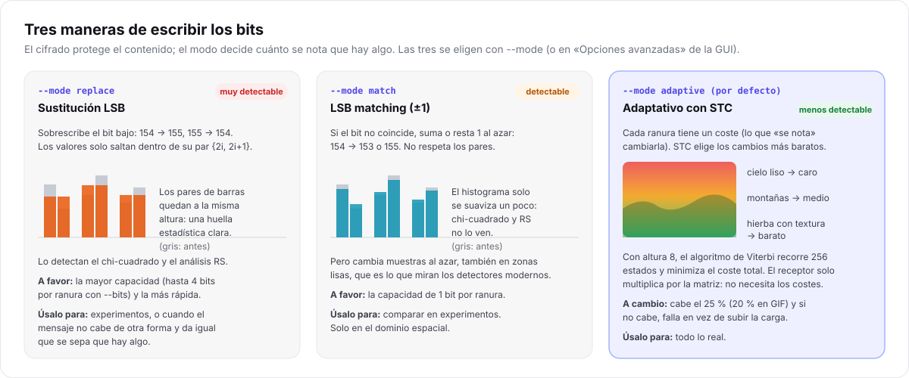
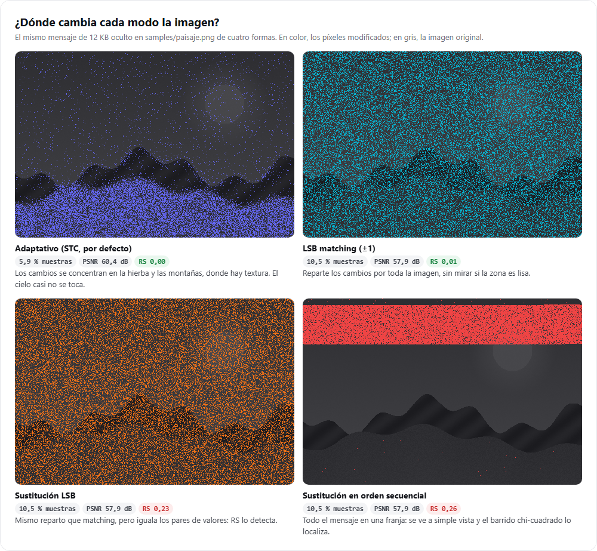
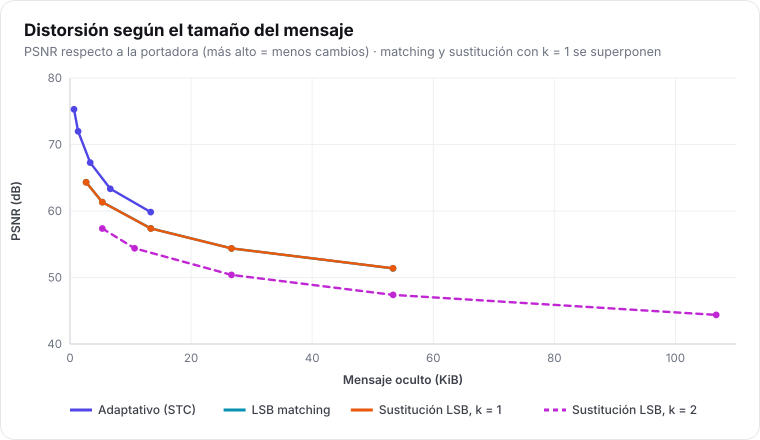

# Esteganografía: dominios, modos y STC

> **Para quién:** quien quiera entender *cómo* se esconden los bits y por qué el modo adaptativo es
> menos detectable. Incluye las ideas matemáticas justas, con referencias para profundizar.

## 1. La idea

Una imagen digital es una tabla de números. Cambiar el último bit de algunos de ellos (sumar o
restar 1 sobre 255) no se ve a simple vista. Si esos bits forman un mensaje cifrado, la imagen lo
transporta sin que lo parezca.



El reto no es esconder bits, que es fácil, sino **esconderlos sin dejar huella estadística**. Una
foto natural tiene regularidades (zonas lisas, correlaciones entre vecinos, histogramas con forma
concreta) y una inserción descuidada las rompe. De ahí los tres modos de escritura y la elección de
dónde escribir.

## 2. Dominios

Lo decide el formato de **salida** ([detalles por portadora](arquitectura.md#2-la-portadora-una-secuencia-de-ranuras)):



| Dominio | Formatos | Por qué este dominio |
| --- | --- | --- |
| **Espacial** | PNG, BMP, TGA, QOI, PNM | Sin pérdida: cada bit escrito se conserva tal cual. La mayor capacidad. |
| **DCT** | JPEG | Un JPEG no guarda píxeles sino coeficientes de frecuencia cuantizados. Cambiar píxeles y volver a comprimir borraría el mensaje, así que se modifican los coeficientes directamente, sin recomprimir. |
| **Paleta** | GIF | Un GIF guarda índices a una paleta de hasta 256 colores. Se cambia el índice por el de un color casi igual (estilo EzStego). |

Formatos de **solo lectura** (PSD, HDR, PIC) se convierten a PNG.

## 3. Modos de escritura



### Sustitución LSB (`replace`)

Escribe el bit sobrescribiendo el menos significativo: el valor salta dentro de su par
{2i, 2i+1}. Con mensaje aleatorio, la mitad de las veces el bit ya coincide.

**Huella.** Las frecuencias de cada par tienden a igualarse. Es exactamente lo que mide el test
chi-cuadrado de Westfeld y Pfitzmann, y lo que estima el análisis RS de Fridrich.

Permite **k = 1 a 4 bits por ranura** (solo en espacial): la capacidad se multiplica por k y la
distorsión crece mucho más deprisa (con la imagen de ejemplo llena, el PSNR pasa de ~51 dB con
k = 1 a ~32 dB con k = 4).

### LSB matching (`match`)

Si el bit no coincide, suma o resta 1 al azar. El valor puede salir de su par, así que el
histograma no se iguala por pares: chi-cuadrado y RS **no lo detectan**. Pero cambia muestras sin
mirar dónde, también en zonas lisas, y los detectores modernos (que modelan la relación entre
píxeles vecinos) sí lo encuentran. Solo en el dominio espacial.

### Adaptativo (`adaptive`, por defecto)

Asigna a cada ranura un **coste**, lo que «se nota» modificarla, y elige el conjunto de cambios que
codifica el mensaje con el **menor coste total**. Los cambios se van a las zonas con textura, donde
un ±1 se pierde en el ruido natural de la imagen.



**Funciones de coste:**

| Dominio | Coste | Idea |
| --- | --- | --- |
| Espacial | **HILL** (Li et al., 2014) | Filtro de paso alto (KB 3×3) → valor absoluto → suavizado. Coste ≈ 1 / textura local: alto en el cielo, bajo en la hierba. |
| DCT | **UERD** (Guo et al., 2015) | Coste según la energía del bloque y el paso de cuantización de cada frecuencia. Los bloques planos y las frecuencias con pasos pequeños son caros. |
| Paleta | distancia de color | La distancia euclídea entre los dos colores del par. |

Lo que no se puede tocar (ceros en JPEG, colores sin pareja, transparencia) tiene coste infinito.

**Carga prudente.** El modo adaptativo limita el mensaje a **0,25 bits por ranura cambiable**
(0,20 en paleta). Por encima, cualquier modo empieza a ser detectable. Si el mensaje no cabe,
I-CPU **falla y lo explica** en vez de subir la carga sin avisar.

## 4. Syndrome-Trellis Codes

El problema que resuelve STC: tengo n bits bajos `x` de la imagen, cada uno con su coste ρᵢ, y
quiero que el receptor lea un mensaje m de longitud m < n. ¿Qué bits cambio?

**Codificación por síndrome.** Emisor y receptor comparten una matriz de paridad **H** (m × n). El
mensaje es el **síndrome** de los bits que se leen:

```text
receptor:  m = H · y   (mod 2)
emisor:    busca y lo más parecido a x (con coste mínimo) tal que H · y = m
```

El receptor no necesita saber qué bits se cambiaron ni los costes: solo multiplica.

**Trellis.** H se construye repitiendo en diagonal una submatriz pequeña Ĥ de altura h (en I-CPU,
**h = 8**). Así, el problema de buscar el y de coste mínimo se convierte en el camino más corto en un
grafo por capas (el *trellis*) con 2ʰ = 256 estados por columna, que se resuelve con el **algoritmo
de Viterbi** en O(n · 2ʰ).

**Detalles de la implementación** (`src/stego/stc.cpp`):

- Las columnas de Ĥ son **constantes del formato** (el primer y el último bit a 1, para que cada
  columna afecte a todo el bloque). La tasa m/n se ajusta repartiendo los n elementos en bloques de
  ancho w y w + 1.
- La secuencia se divide en **segmentos** de hasta 2²⁰ elementos que se resuelven en paralelo, para
  limitar la memoria del trellis. Una excepción en un hilo se relanza al terminar, en lugar de
  cerrar el programa.
- Si no hay solución con coste finito (demasiadas ranuras prohibidas en un tramo), se rehace el plan
  con **otra sal**, y por tanto con otras posiciones, hasta 3 veces. Si sigue sin haberla, el error
  es de capacidad y explica el motivo.
- La **dirección** de cada cambio (+1 o −1) se elige al azar: STC binario, no ternario.
- La sal y la cabecera también se escriben con STC, en bloques de W ranuras por bit, para que sus
  cambios tampoco caigan en zonas lisas ([formato](formato.md#21-w)).

**Altura 8.** Es el equilibrio elegido: h = 10, habitual en la literatura, ahorra algo de
distorsión pero tarda cuatro veces más ([D8](decisiones-de-diseno.md#d8-inserción-adaptativa-con-stc-por-defecto)).

## 5. Orden aleatorio y secuencial

- **Aleatorio** (por defecto): las ranuras se recorren en una permutación secreta derivada de la
  contraseña. Los cambios quedan repartidos por toda la imagen.
- **Secuencial** (`--layout sequential`): 0, 1, 2… Existe solo para **experimentos**: concentra todo
  el mensaje en una franja visible y el barrido chi-cuadrado por ventanas lo localiza.

## 6. Resultados

Con el mismo mensaje de 12 KB en `samples/paisaje.png` (480 × 320 px):

| Modo | Muestras cambiadas | PSNR | SSIM | Tasa RS |
| --- | --- | --- | --- | --- |
| Portadora limpia | 0 % | ∞ | 1 | 0,011 |
| **Adaptativo** | **5,9 %** | **60,4 dB** | **0,99985** | **≈ 0,00** |
| LSB matching | 10,5 % | 57,9 dB | 0,99947 | 0,014 |
| Sustitución LSB | 10,5 % | 57,9 dB | 0,99946 | 0,225 |
| Sustitución secuencial | 10,5 % | 57,9 dB | 0,99930 | 0,259 |



Las cifras salen de [`scripts/generar_figuras.mjs`](../../scripts/generar_figuras.mjs); cómo
reproducirlas e interpretarlas está en la [guía de experimentos](../guias/experimentos.md).

## Referencias

- T. Filler, J. Judas, J. Fridrich. *Minimizing Additive Distortion in Steganography Using
  Syndrome-Trellis Codes*. IEEE TIFS, 2011.
- B. Li, M. Wang, J. Huang, X. Li. *A New Cost Function for Spatial Image Steganography* (HILL). ICIP, 2014.
- L. Guo, J. Ni, W. Su, C. Tang, Y. Shi. *Using Statistical Image Model for JPEG Steganography:
  Uniform Embedding Revisited* (UERD). IEEE TIFS, 2015.
- R. Machado. *EzStego*, 1996.
- J. Fridrich. *Steganography in Digital Media: Principles, Algorithms, and Applications*.
  Cambridge University Press, 2009.
