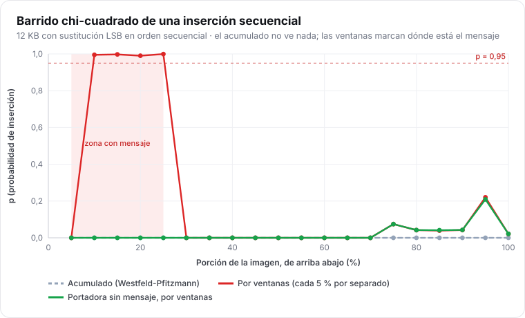
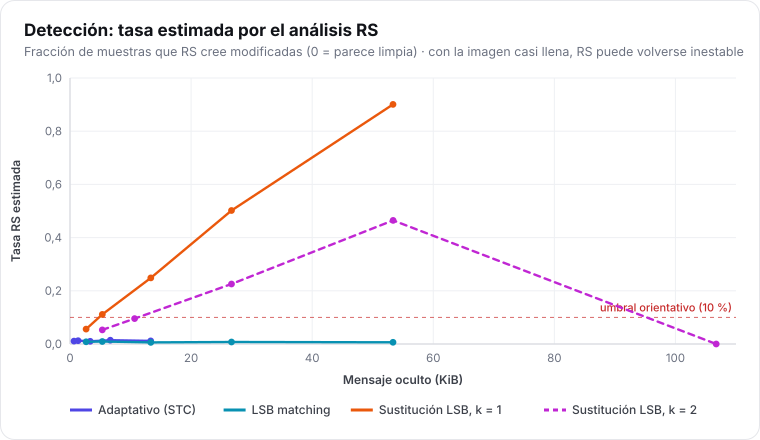

# Estegoanálisis y métricas

> **Para quién:** quien quiera evaluar lo detectable que es una imagen, interpretar la pestaña
> *Analizar* o el comando `icpu analyze`, o diseñar sus propios experimentos.

El estegoanálisis es el «otro lado»: intentar averiguar si una imagen lleva un mensaje. I-CPU
incluye los ataques **clásicos**, que sirven para entender los modos y comparar configuraciones.
**No** incluye los detectores modernos, así que un resultado limpio aquí no garantiza que la imagen
sea indetectable.

## 1. Métricas de distorsión

Comparan la imagen con su original (`--cover` en la CLI, «Portadora original» en la GUI).

| Métrica | Qué mide | Cómo leerla |
| --- | --- | --- |
| **MSE** | error cuadrático medio por muestra | 0 = idénticas |
| **PSNR** | 10·log₁₀(255² / MSE), en dB | > 50 dB: imperceptible; ∞ si son idénticas |
| **SSIM** | similitud estructural (luminancia, contraste, estructura) | 1 = idénticas; > 0,99: imperceptible |
| **Muestras cambiadas** | fracción de muestras con algún cambio | menos es mejor |
| **Diferencia máxima** | mayor cambio en una muestra | 1 con `adaptive` y `match`; hasta 2ᵏ − 1 con `replace` |

La distorsión baja **no** implica que sea indetectable: los detectores no miran cuánto cambia la
imagen, sino **dónde** y **cómo**.

## 2. Test chi-cuadrado (Westfeld y Pfitzmann, 1999)

**Idea.** La sustitución LSB solo mueve valores dentro de cada par {2i, 2i+1} y, con un mensaje
aleatorio, tiende a igualar sus frecuencias. El test compara el histograma real con el que tendría
si cada par estuviera igualado:

```text
χ² = Σ (h[2i] − e_i)² / e_i,   e_i = (h[2i] + h[2i+1]) / 2   (solo pares con e_i ≥ 5)
p  = 1 − F_χ²(χ², gl = pares − 1)
```

`p` cercano a **1** → pares igualados → **inserción probable**. `p` ≈ 0 → sin indicios.

**Limitación.** Solo ve la sustitución LSB. LSB matching y el modo adaptativo no igualan los pares.

### Barrido chi-cuadrado

En lugar de toda la imagen, se calcula por porciones, de arriba abajo. I-CPU da **dos curvas**
([D9](../tecnico/decisiones-de-diseno.md#d9-barrido-chi-cuadrado-acumulado-y-por-ventanas)):

- **Acumulado** (el clásico): desde el principio hasta cada porción. Delata una inserción
  secuencial que empieza en el primer píxel.
- **Por ventanas**: cada porción por separado. Marca p ≈ 1 justo donde está el mensaje.



En el formato v3 el acumulado ya no ve las inserciones secuenciales: las primeras filas son la
cabecera, escrita con STC y casi intacta, y con decenas de miles de muestras basta ese trozo para
que p caiga a 0. Las ventanas, en cambio, señalan la franja con el mensaje. En imágenes pequeñas o
muy ruidosas, una ventana limpia también puede dar p alto: con pocas muestras, el test discrimina menos.

## 3. Análisis RS (Fridrich, Goljan y Du, 2001)

**Idea.** Divide la imagen en grupos de 4 píxeles y mide su «suavidad». Aplica dos volteos de bits
(F₁: 0↔1, 2↔3…; F₋₁: −1↔0, 1↔2…) y cuenta cuántos grupos se vuelven más rugosos (*Regulares*) o
más suaves (*Singulares*). En una imagen natural, los dos volteos se comportan igual; la
sustitución LSB rompe esa simetría de una forma predecible, y de ahí sale una **estimación de la
fracción de muestras modificadas**.

| Tasa RS | Veredicto de I-CPU |
| --- | --- |
| ≤ 3 % | sin indicios |
| 3–10 % | dudoso |
| > 10 % | inserción probable |

Para el chi-cuadrado, los veredictos son: p ≤ 0,5 sin indicios, 0,5–0,95 dudoso y > 0,95
inserción muy probable (`chi_square_verdict` y `rs_verdict` en `src/report.cpp`). Son orientativos:
una foto con mucho ruido puede dar valores dudosos sin llevar nada.

**Limitaciones.** Solo es fiable con la sustitución LSB. Con LSB matching y el modo adaptativo se
queda en el nivel de la imagen limpia. Se vuelve inestable con la imagen casi llena.



## 4. Chi-cuadrado DCT

La versión del test chi-cuadrado para JPEG: se aplica al histograma de los **coeficientes AC**
(sin 0 ni 1), donde JSteg igualaba pares. Desde la 2.0, I-CPU usa pares simétricos por magnitud
y el modo adaptativo con UERD, así que este test no lo detecta; sirve para comparar con el esquema antiguo.

En JPEG no se aplican los tests sobre píxeles: la descompresión mezcla los coeficientes de cada
bloque y los resultados no tendrían sentido.

## 5. Visualizaciones

| Visualización | Qué enseña | CLI (`--export`) |
| --- | --- | --- |
| **Planos de bits** 0 y 1 | En una foto natural, el plano 0 conserva algo de estructura; un mensaje cifrado lo convierte en ruido uniforme. | `plano_bit0.png`, `plano_bit1.png` |
| **Mapa de diferencias** | Dónde cambió la imagen, amplificado. | `diferencias.png` |
| **Histograma** por canal | La forma de la distribución de valores. | `histograma.csv` |
| **Barrido χ²** | Acumulado y por ventanas. | `barrido_chi2.csv` |

En la GUI, el comparador antes/después, la vista «Diferencias ×64» y la **lupa** de píxeles
permiten ver los cambios uno a uno.

## 6. Qué no detecta este análisis (y qué sí lo haría)

El estado del arte usa:

- **Modelos ricos (SRM, maxSRM)**: miles de características de los residuos entre píxeles vecinos,
  con un clasificador entrenado (*ensemble*). Detectan LSB matching y modos adaptativos con
  cargas mucho menores que los tests clásicos.
- **Redes neuronales** (Yedroudj-Net, SRNet…), entrenadas con imágenes limpias y con mensaje.

I-CPU **no se ha evaluado** frente a ellos. La carga prudente del modo adaptativo (0,25 bits por
ranura) está por debajo de la que suelen detectar con fiabilidad en la literatura, pero eso depende
de la imagen y no es una garantía. Evaluarlo es una de las líneas de [trabajo futuro](../sobre-el-proyecto.md#trabajo-futuro).

## Referencias

- A. Westfeld, A. Pfitzmann. *Attacks on Steganographic Systems*. Information Hiding, 1999.
- J. Fridrich, M. Goljan, R. Du. *Reliable Detection of LSB Steganography in Color and Grayscale
  Images*. ACM Workshop on Multimedia and Security, 2001.
- J. Fridrich, J. Kodovský. *Rich Models for Steganalysis of Digital Images*. IEEE TIFS, 2012.
- Z. Wang, A. Bovik, H. Sheikh, E. Simoncelli. *Image Quality Assessment: From Error Visibility to
  Structural Similarity* (SSIM). IEEE TIP, 2004.
