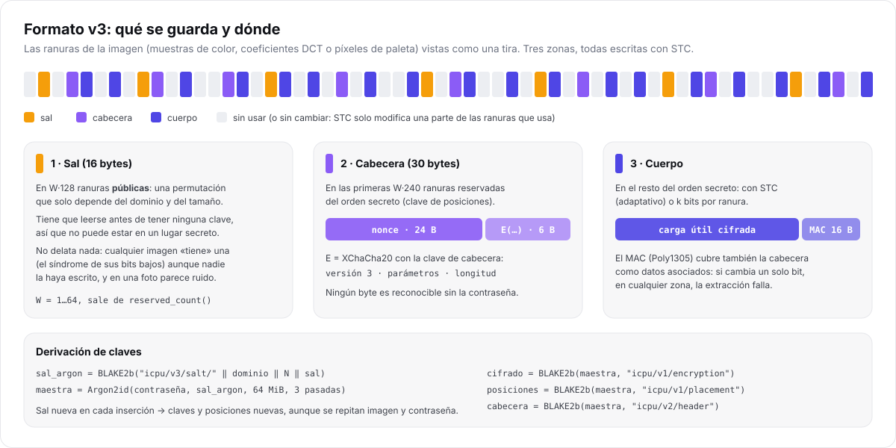

# Especificación del formato v3

> **Para quién:** quien quiera implementar un lector compatible, auditar el diseño o entender qué
> queda exactamente dentro de una imagen. Es la referencia normativa: si el código y este documento
> discrepan, es un fallo.

Desde I-CPU 2.0 todas las imágenes se escriben en **v3**. Las versiones v1 (I-CPU 1.0) y v2
(I-CPU 1.5) solo se leen; su descripción está al final.



## 1. Conceptos

| Término | Definición |
| --- | --- |
| **Ranura** | Unidad mínima donde se guarda un bit: muestra de color, coeficiente DCT o píxel de paleta ([portadoras](arquitectura.md#2-la-portadora-una-secuencia-de-ranuras)). |
| **N** | Número total de ranuras de la imagen (`slot_count()`). |
| **Ranura reservada** | Ranura que ningún modo deja de considerar utilizable después de escribirla (`reserved_usable`). Llevan la sal y la cabecera. |
| **Dominio** | `espacial`, `dct` o `paleta`. Forma parte de la derivación de la sal. |
| **W** | Ancho de los bloques de STC para la sal y la cabecera: ranuras por cada bit. |
| **k** | Bits por ranura del cuerpo con `replace` (1 a 4). |

## 2. Estructura

El contenedor tiene tres zonas, todas escritas con **STC de altura 8**, sea cual sea el modo:

| Zona | Tamaño | Ranuras | Clave necesaria para leerla |
| --- | --- | --- | --- |
| Sal | 16 bytes (128 bits) | W·128 ranuras reservadas en orden **público** | ninguna |
| Cabecera | 30 bytes (240 bits) | primeras W·240 ranuras reservadas del orden **secreto**, sin las de la sal | posiciones + cabecera |
| Cuerpo | `longitud` bytes (incluye MAC) | resto del orden secreto | posiciones + cifrado |

### 2.1 W

W no se guarda: el lector lo recalcula a partir de `reserved_count()`, que no cambia al escribir.

```text
presupuesto = reserved_count()                  si las reservadas no las usa el cuerpo
            = reserved_count() / 8              si las comparte con el cuerpo
W           = clamp(presupuesto / 368, 1, 64)   (368 = 128 + 240 bits de sal y cabecera)
```

Con W = 1 (imágenes muy pequeñas), STC equivale a escribir bit a bit. En JPEG las ranuras
reservadas son los coeficientes DC, uno por bloque: hacen falta **al menos 368 bloques**
(unos 130×130 píxeles en 4:2:0).

### 2.2 Orden público (sal)

Una permutación ChaCha20 cuya clave es un hash BLAKE2b del dominio y de N. Se recorre y se toman las
primeras W·128 ranuras reservadas. Cualquiera puede calcularla: la sal tiene que poder leerse
antes de conocer ninguna clave.

### 2.3 Orden secreto (cabecera y cuerpo)

`make_slot_order(layout, N, clave_posiciones)`:

- `random` (por defecto): una permutación de Fisher-Yates «perezosa» alimentada por ChaCha20 con la
  clave de posiciones. Solo genera la permutación hasta donde hace falta, con una tabla hash
  mientras se usa poco de la imagen y un vector denso a partir de 1/8.
- `sequential` (solo experimentos): 0, 1, 2…

Se toman primero las W·240 ranuras reservadas que no sean de la sal (cabecera) y después, en el
mismo orden, las del cuerpo, excluyendo sal y cabecera.

## 3. Cabecera

```text
offset  tamaño  campo
0       24      nonce          aleatorio, también es el nonce del AEAD
24      6       E(cabecera en claro)
```

Cabecera en claro (6 bytes), cifrada con XChaCha20(clave de cabecera, nonce):

| Byte | Campo | Valores |
| --- | --- | --- |
| 0 | versión | `3` |
| 1 | parámetros | bits 0–1: k − 1 · bit 2: LSB matching · bit 3: orden secuencial · bit 4: modo adaptativo · bits 5–7: deben ser 0 |
| 2–5 | longitud | tamaño del cuerpo sellado (cifrado + MAC), little-endian |

El lector descarta una cabecera **no plausible**: versión distinta, bits reservados no nulos,
orden distinto del que se pide, k mayor que el que admite la portadora, una longitud menor que el
MAC o que no cabe en la imagen, o el modo adaptativo combinado con k > 1 o con matching. Con una
contraseña incorrecta los 6 bytes son aleatorios y casi siempre fallan aquí, antes de leer el cuerpo.

> Las constantes están en `src/stego/engine.cpp` (`kParamMatch`, `kParamSequential`,
> `kParamAdaptive`, `encode_params`, `plausible`). Cualquier cambio exige una versión nueva del formato.

## 4. Cuerpo

```text
cuerpo = XChaCha20-Poly1305(clave = cifrado, nonce, ad = cabecera en claro completa, texto = carga útil)
       = texto cifrado ‖ MAC (16 bytes)
```

Los **datos asociados** son los 30 bytes de la cabecera *descifrada*: nonce + versión + parámetros +
longitud. Si cambia un solo bit de la cabecera o del cuerpo, el descifrado falla.

### 4.1 Carga útil (antes de cifrar)

```text
flags (1) | longitud del nombre (1) | nombre (0–255, UTF-8) | tamaño original (4) | datos
```

- `flags`: bit 0, datos comprimidos con DEFLATE; bit 1, es un fichero (si no, un texto). Cualquier
  otro bit a 1 se rechaza como carga dañada.
- Los enteros (`tamaño original`) van en little-endian.
- `nombre`: solo para ficheros; nombre base sin rutas. Al extraer se neutraliza (rutas, `C:x`,
  flujos NTFS `x:y`, caracteres de control y nombres de dispositivo como `NUL`).
- `tamaño original`: tamaño sin comprimir, que acota la descompresión.

## 5. Escritura del cuerpo según el modo

| Modo | Escritura | Capacidad |
| --- | --- | --- |
| `adaptive` | STC de altura 8 sobre todas las ranuras del orden secreto; costes HILL, UERD o distancia de color | 0,25 bits por ranura cambiable (0,20 en paleta) |
| `replace` | k bits por ranura, sobrescritos | k bits por ranura utilizable |
| `match` | 1 bit por ranura con ±1 aleatorio (solo espacial) | 1 bit por ranura |

En modo adaptativo el lector no necesita los costes: calcula el síndrome con la matriz de paridad
sobre los bits bajos de la secuencia completa ([STC](esteganografia.md#4-syndrome-trellis-codes)).

## 6. Algoritmo de extracción

```text
1. sal ← STC⁻¹(bits bajos de las W·128 ranuras del orden público)
2. claves ← derivar(contraseña, dominio, N, sal)                 (ver criptografía)
3. cabecera ← STC⁻¹(W·240 ranuras reservadas del orden secreto); descifrar los 6 bytes
4. si no es plausible → probar el formato antiguo (v2, v1) con su propia sal
5. cuerpo ← leer `longitud` bytes según el modo; AEAD.abrir(cuerpo, ad = cabecera)
6. si el MAC falla → probar v2 y v1; si también fallan → error de autenticación
7. desempaquetar y, si procede, descomprimir
```

## 7. Versiones anteriores (solo lectura)

| | v1 (I-CPU 1.0) | v2 (I-CPU 1.5) | v3 (I-CPU 2.0) |
| --- | --- | --- | --- |
| Sal | derivada de la imagen | derivada de la imagen | aleatoria, guardada |
| Cabecera | en claro: versión, parámetros, nonce, longitud | cifrada | cifrada |
| Escritura de sal y cabecera | — / bit a bit | bit a bit | STC |
| Pares en DCT | JSteg (−1 se toca, +1 no) | JSteg | simétricos por magnitud |
| Debilidad principal | firma reconocible en orden secuencial | posiciones repetidas con la misma imagen y contraseña | ver [limitaciones](arquitectura.md#8-limitaciones-conocidas) |

El código de lectura está aislado en `src/stego/legacy.cpp` y se prueba con las imágenes reales de
`tests/golden/` (`v1_*`, `v2_*`, `v3_*`). Si te importa la confidencialidad de un mensaje antiguo,
extráelo y vuelve a ocultarlo con la 2.0.

## 8. Compatibilidad hacia delante

- La versión va **cifrada**: un lector solo la ve si la contraseña es correcta.
- Cambiar la disposición de la sal, el cálculo de W, los parámetros de Argon2id, el empaquetado o
  la asignación de bits de la cabecera exige **v4**, y v3 pasaría a `legacy.cpp`.
