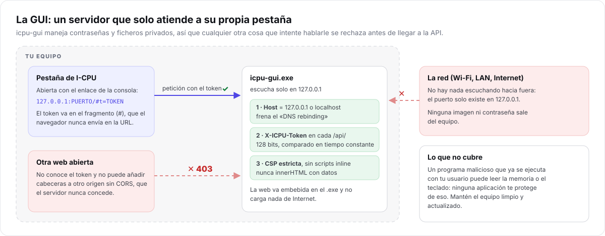
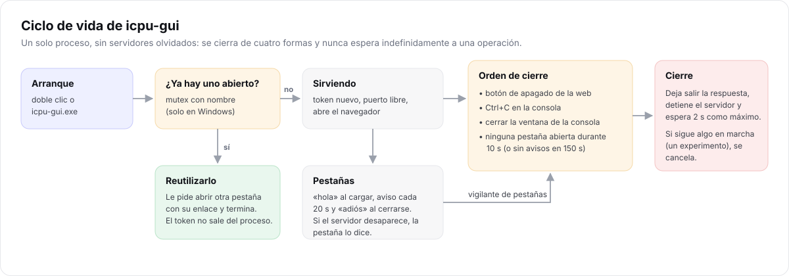

# Interfaz web y API HTTP

> **Para quién:** desarrolladores que quieran modificar la GUI, automatizarla o revisar su
> seguridad. Si solo quieres usarla, ve a la [guía de la interfaz gráfica](../guias/interfaz-grafica.md).

`icpu-gui` es un servidor HTTP local ([cpp-httplib](https://github.com/yhirose/cpp-httplib)) que
sirve una aplicación web embebida en el propio ejecutable. Por qué así y no con Qt o Electron:
[D3](decisiones-de-diseno.md#d3-la-gui-es-un-servidor-web-local-con-token).

## Seguridad



Antes de cualquier ruta, un *pre-routing handler* (`apps/gui/server.cpp`, `configure`) comprueba:

1. **Host**: solo `127.0.0.1:puerto` o `localhost:puerto`. Cualquier otro → `403 host`. Protege
   frente a *DNS rebinding*: una web maliciosa que haga que su dominio resuelva a 127.0.0.1 seguiría
   enviando su propio `Host`.
2. **Token**: toda ruta bajo `/api/` exige `X-ICPU-Token` igual al token de la sesión, comparado en
   tiempo constante. Si no → `403 token`.

Y además:

- El servidor solo se enlaza a **127.0.0.1**: no hay nada accesible desde la red.
- El token (128 bits del generador del sistema) llega en el **fragmento** de la URL (`#t=…`), que el
  navegador no envía. La web lo guarda en `sessionStorage` para sobrevivir a una recarga y lo borra
  de la barra de direcciones.
- El frontend se sirve con `Content-Security-Policy: default-src 'self'; …; frame-ancestors 'none'`,
  `X-Content-Type-Options: nosniff` y `Referrer-Policy: no-referrer`. No hay scripts inline ni
  recursos externos, y todo dato se inserta con `textContent`, nunca con `innerHTML`.
- Las subidas se limitan a 256 MiB.
- El historial y las descargas viven **solo en memoria**: guardar nombres de fichero en el navegador
  dejaría rastro del uso de la herramienta.

## Ciclo de vida



`run_server` lanza un **hilo de ciclo de vida** que espera una orden de cierre:

| Origen | Cómo llega |
| --- | --- |
| Botón de apagado | `POST /api/shutdown` → `Lifecycle::request_shutdown` |
| Ctrl+C, Ctrl+Break | manejador de consola (Windows) o señal `SIGINT`/`SIGTERM` (POSIX), que solo marca una variable atómica |
| Cerrar la ventana de la consola | `CTRL_CLOSE_EVENT`: Windows da unos segundos antes de terminar el proceso |
| Ninguna pestaña abierta | `TabTracker::abandoned`: sin pestañas durante 10 s, o sin avisos durante 150 s |

Al recibirla: espera 300 ms para que la respuesta llegue al navegador, llama a `svr.stop()` y da
**2 s** a las peticiones en curso. Si alguna sigue (un experimento, STC sobre una imagen grande),
termina el proceso con `std::_Exit(0)`: su resultado ya no tiene a quién llegar.

**Presencia de pestañas.** Cada pestaña genera un identificador aleatorio y llama a
`/api/presence` con `hello` al cargar, `ping` cada 20 s y `bye` al cerrarse (`pagehide`, con
`fetch(..., { keepalive: true })` para que la petición sobreviva al cierre). Los 150 s de caducidad
cubren el caso de un navegador que se cierra de golpe; son tan largos porque los navegadores
ralentizan los temporizadores de las pestañas en segundo plano. Los 10 s de margen evitan cerrar al
recargar la página. Si el servidor no responde a dos avisos seguidos, la pestaña muestra
«I-CPU se ha cerrado».

**Instancia única (Windows).** Un mutex con nombre (`Local\ICPU-GUI-instance`) detecta si ya hay una
I-CPU abierta. Si la hay, la nueva activa un evento con nombre (`Local\ICPU-GUI-open-browser`); la
existente lo ve y abre otra pestaña con **su** enlace, y la nueva termina. El token nunca sale del
proceso que lo creó, ni a disco ni a otro proceso.

**Prueba de extremo a extremo.** Con un navegador real se comprobó: botón de apagado (el proceso
termina, `exit 0`), cierre de la última pestaña (termina a los ~10 s), servidor cerrado desde fuera
(la pestaña lo muestra) y cierre con un experimento de 60 ejecuciones en marcha (termina en ~2,5 s).

## API

Todas las rutas `/api/*` exigen `X-ICPU-Token`. Las entradas van en **multipart/form-data** y las
respuestas en JSON (UTF-8), salvo donde se indica.

> El formulario multipart **no puede ir vacío**: cpp-httplib responde `400` a un multipart sin
> partes. Por eso la web envía un campo explícito incluso en `/api/shutdown`.

| Ruta | Entrada | Respuesta |
| --- | --- | --- |
| `GET /api/version` | — | `{"version":"2.0.0"}` |
| `POST /api/info` | `image` | formato, dimensiones, fotogramas, calidad JPEG estimada y capacidades (también la adaptativa) |
| `POST /api/embed` | `cover`; `message` (texto) o `payload` (fichero); `password`; opcionales `format` (`auto`), `mode` (`adaptive`), `bits` (`auto` o 1–4), `layout` (`random`), `quality` (90), `compress` (`1`/`0`) | `image` en base64, `filename` sugerido (mismo nombre que la portadora), estadísticas, PSNR/SSIM, mapa de diferencias y vistas previas PNG si el navegador no sabe mostrar el formato |
| `POST /api/extract` | `image`, `password`, `layout` | `kind` (`text` o `file`), `name`, `text` (solo textos) y `data` en base64 |
| `POST /api/analyze` | `image`; `cover` opcional; `steps` (20) | tests (χ², barrido acumulado y por ventanas, RS, χ² DCT), histogramas, planos de bits y calidad |
| `POST /api/bench` | `cover`; listas `fills`, `bits`, `modes`, `layouts`; `format` | **NDJSON en streaming** (ver abajo) |
| `POST /api/preview` | `image` | `image/png`: vista previa de QOI, TGA, PNM, PSD… |
| `POST /api/presence` | `tab` (≤ 64 caracteres), `event` = `hello` \| `ping` \| `bye` | `{"ok":true}` |
| `POST /api/shutdown` | cualquier campo | `{"ok":true}`; el servidor se cierra después |

**Errores.** `{"error":"mensaje legible","code":"…"}` con el estado HTTP de la
[tabla de errores](arquitectura.md#5-errores). La contraseña incorrecta da `422`.

**Experimento en streaming.** Una línea JSON por evento:

```text
{"type":"progress","done":0,"total":40}
{"type":"progress","done":1,"total":40}
…
{"type":"result","output":"PNG","domain":"espacial","baseline":{…},"runs":[…]}
```

o `{"type":"error","error":"…"}` si los parámetros no son válidos. Si el navegador se va (pestaña
cerrada), la siguiente escritura falla y el experimento se aborta.

### Ejemplo con curl

```bash
# El token es lo que aparece tras #t= en el enlace de la consola
T=0123456789abcdef0123456789abcdef
curl -H "X-ICPU-Token: $T" http://127.0.0.1:PUERTO/api/version
curl -H "X-ICPU-Token: $T" -F image=@samples/demo_mensaje.png -F password=icpu-demo \
     http://127.0.0.1:PUERTO/api/extract
```

## Frontend

`apps/gui/web/` contiene `index.html`, `app.css`, `app.js` y `favicon.svg`. Al compilar,
`embed_assets.cmake` los convierte en arrays de bytes (`web_assets.cpp`): cualquier cambio en la web
exige recompilar.

- **Sin dependencias**: ni frameworks ni bibliotecas de gráficas. Las gráficas son SVG generado en
  JavaScript (con exportación a PNG) y el comparador y la lupa trabajan sobre `<canvas>`.
- **Temas** claro, oscuro y automático con variables CSS en `:root`.
- **Accesibilidad**: pestañas con roles ARIA y navegación por teclado, diálogos `<dialog>` nativos,
  avisos con `aria-live`, foco visible.
- **Atajos**: `Ctrl+Enter` ejecuta, `Alt+1…4` cambia de pestaña, `Alt+H` abre el historial, `?` muestra
  la ayuda, `Esc` cierra paneles.

## Pruebas

`tests/test_gui.cpp` arranca el servidor de verdad en un hilo (por eso es una biblioteca,
`icpu_gui_server`) y lo prueba con un cliente HTTP: seguridad (token, Host, cabeceras), ocultar →
extraer, vista previa, streaming del experimento, presencia de pestañas y apagado. El seguimiento de
pestañas (`TabTracker`) recibe el reloj como argumento, así que sus pruebas no esperan de verdad.
